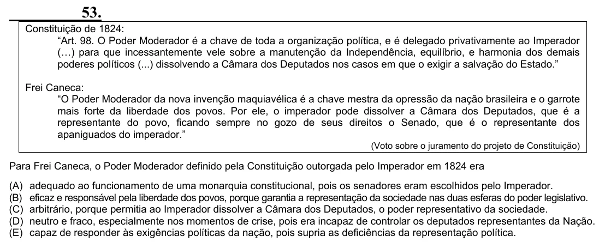

Texto extraído (pode conter ruído)

53.  
Constituição de 1824:  
“Art. 98. O Poder Moderador é a chave de toda a organização política, e é delegado privativamente ao Imperador  
(…) para que incessantemente vele sobre a manutenção da Independência, equilíbrio, e harmonia dos demais  
poderes políticos (...) dissolvendo a Câmara dos Deputados nos casos em que o exigir a salvação do Estado.”  
Frei Caneca:  
“O Poder Moderador da nova invenção maquiavélica é a chave mestra da opressão da nação brasileira e o garrote  
mais forte da liberdade dos povos. Por ele, o imperador pode dissolver a Câmara dos Deputados, que é a  
representante do povo, ficando sempre no gozo de seus direitos o Senado, que é o representante dos  
apaniguados do imperador.”  
(Voto sobre o juramento do projeto de Constituição)  
Para Frei Caneca, o Poder Moderador definido pela Constituição outorgada pelo Imperador em 1824 era  
(A) adequado ao funcionamento de uma monarquia constitucional, pois os senadores eram escolhidos pelo Imperador.  
(B) eficaz e responsável pela liberdade dos povos, porque garantia a representação da sociedade nas duas esferas do poder legislativo.  
(C) arbitrário, porque permitia ao Imperador dissolver a Câmara dos Deputados, o poder representativo da sociedade.  
(D) neutro e fraco, especialmente nos momentos de crise, pois era incapaz de controlar os deputados representantes da Nação.  
(E) capaz de responder às exigências políticas da nação, pois supria as deficiências da representação política.

