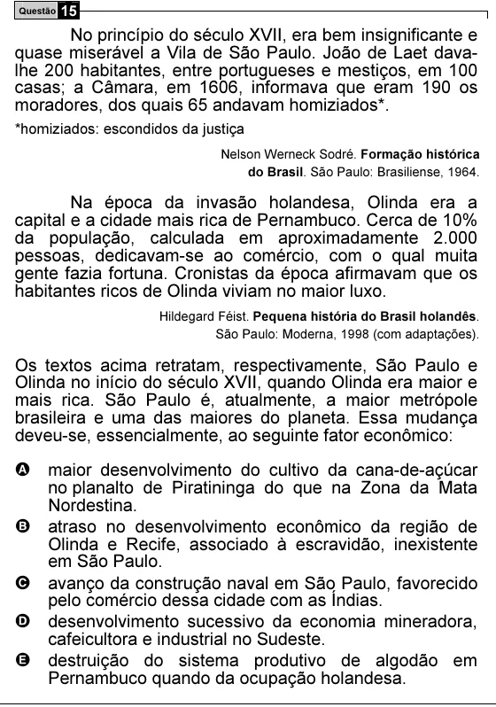

Texto extraído (pode conter ruído)

Questão 15  
No princípio do século XVII, era bem insignificante e  
quase miserável a Vila de São Paulo. João de Laet dava-  
lhe 200 habitantes, entre portugueses e mestiços, em 100  
casas; a Câmara, em 1606, informava que eram 190 os  
moradores, dos quais 65 andavam homiziados*.  
*homiziados: escondidos da justiça  
Nelson Werneck Sodré. Formação histórica  
do Brasil. São Paulo: Brasiliense, 1964.  
Na época da invasão holandesa, Olinda era a  
capital e a cidade mais rica de Pernambuco. Cerca de 10%  
da população, calculada em aproximadamente 2.000  
pessoas, dedicavam-se ao comércio, com o qual muita  
gente fazia fortuna. Cronistas da época afirmavam que os  
habitantes ricos de Olinda viviam no maior luxo.  
Hildegard Féist. Pequena história do Brasil holandês.  
São Paulo: Moderna, 1998 (com adaptações).  
Os textos acima retratam, respectivamente, São Paulo e  
Olinda no início do século XVII, quando Olinda era maior e  
mais rica. São Paulo é, atualmente, a maior metrópole  
brasileira e uma das maiores do planeta. Essa mudança  
deveu-se, essencialmente, ao seguinte fator econômico:  
A maior desenvolvimento do cultivo da cana-de-açúcar  
no planalto de Piratininga do que na Zona da Mata  
Nordestina.  
B atraso no desenvolvimento econômico da região de  
Olinda e Recife, associado à escravidão, inexistente  
em São Paulo.  
C avanço da construção naval em São Paulo, favorecido  
pelo comércio dessa cidade com as Índias.  
D desenvolvimento sucessivo da economia mineradora,  
cafeicultora e industrial no Sudeste.  
E destruição do sistema produtivo de algodão em  
Pernambuco quando da ocupação holandesa.

