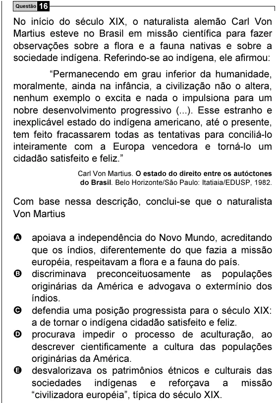

Texto extraído (pode conter ruído)

Questão 16  
No início do século XIX, o naturalista alemão Carl Von  
Martius esteve no Brasil em missão científica para fazer  
observações sobre a flora e a fauna nativas e sobre a  
sociedade indígena. Referindo-se ao indígena, ele afirmou:  
“Permanecendo em grau inferior da humanidade,  
moralmente, ainda na infância, a civilização não o altera,  
nenhum exemplo o excita e nada o impulsiona para um  
nobre desenvolvimento progressivo (...). Esse estranho e  
inexplicável estado do indígena americano, até o presente,  
tem feito fracassarem todas as tentativas para conciliá-lo  
inteiramente com a Europa vencedora e torná-lo um  
cidadão satisfeito e feliz.”  
Carl Von Martius. O estado do direito entre os autóctones  
do Brasil. Belo Horizonte/São Paulo: Itatiaia/EDUSP, 1982.  
Com base nessa descrição, conclui-se que o naturalista  
Von Martius  
A apoiava a independência do Novo Mundo, acreditando  
que os índios, diferentemente do que fazia a missão  
européia, respeitavam a flora e a fauna do país.  
B discriminava preconceituosamente as populações  
originárias da América e advogava o extermínio dos  
índios.  
C defendia uma posição progressista para o século XIX:  
a de tornar o indígena cidadão satisfeito e feliz.  
D procurava impedir o processo de aculturação, ao  
descrever cientificamente a cultura das populações  
originárias da América.  
E desvalorizava os patrimônios étnicos e culturais das  
sociedades indígenas e reforçava a missão  
“civilizadora européia”, típica do século XIX.

