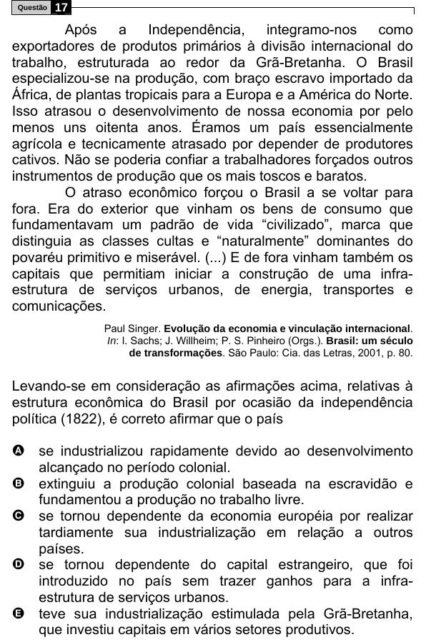

Texto extraído (pode conter ruído)

Questão  
17  
Após  
a  
Independência,  
integramo-nos  
como  
exportadores de produtos primários à divisão internacional do  
trabalho, estruturada ao redor da Grã-Bretanha. O Brasil  
especializou-se na produção, com braço escravo importado da  
África, de plantas tropicais para a Europa e a América do Norte.  
Isso atrasou o desenvolvimento de nossa economia por pelo  
menos uns oitenta anos. Éramos um país essencialmente  
agrícola e tecnicamente atrasado por depender de produtores  
cativos. Não se poderia confiar a trabalhadores forçados outros  
instrumentos de produção que os mais toscos e baratos.  
O atraso econômico forçou o Brasil a se voltar para  
fora. Era do exterior que vinham os bens de consumo que  
fundamentavam um padrão de vida “civilizado”, marca que  
distinguia as classes cultas e “naturalmente” dominantes do  
povaréu primitivo e miserável. (...) E de fora vinham também os  
capitais que permitiam iniciar a construção de uma infra-  
estrutura de serviços urbanos, de energia, transportes e  
comunicações.  
Paul Singer. Evolução da economia e vinculação internacional.  
In: I. Sachs; J. Willheim; P. S. Pinheiro (Orgs.). Brasil: um século  
de transformações. São Paulo: Cia. das Letras, 2001, p. 80.  
Levando-se em consideração as afirmações acima, relativas à  
estrutura econômica do Brasil por ocasião da independência  
política (1822), é correto afirmar que o país  
A se industrializou rapidamente devido ao desenvolvimento  
alcançado no período colonial.  
B extinguiu a produção colonial baseada na escravidão e  
fundamentou a produção no trabalho livre.  
C se tornou dependente da economia européia por realizar  
tardiamente sua industrialização em relação a outros  
países.  
D se tornou dependente do capital estrangeiro, que foi  
introduzido no país sem trazer ganhos para a infra-  
estrutura de serviços urbanos.  
E teve sua industrialização estimulada pela Grã-Bretanha,  
que investiu capitais em vários setores produtivos.

