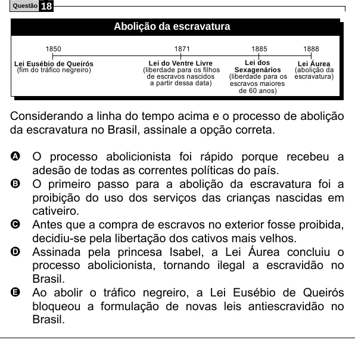

Texto extraído (pode conter ruído)

18  
Questão  
Abolição da escravatura  
1850  
1871  
1885  
1888  
Lei Eusébio de Queirós  
Lei do Ventre Livre  
Lei dos  
Lei Áurea  
(liberdade para os filhos  
(fim do tráfico negreiro)  
Sexagenários  
(abolição da  
de escravos nascidos  
(liberdade para os  
escravatura)  
a partir dessa data)  
escravos maiores  
de 60 anos)  
Considerando a linha do tempo acima e o processo de abolição  
da escravatura no Brasil, assinale a opção correta.  
A O processo abolicionista foi rápido porque recebeu a  
adesão de todas as correntes políticas do país.  
B O primeiro passo para a abolição da escravatura foi a  
proibição do uso dos serviços das crianças nascidas em  
cativeiro.  
C Antes que a compra de escravos no exterior fosse proibida,  
decidiu-se pela libertação dos cativos mais velhos.  
D Assinada pela princesa Isabel, a Lei Áurea concluiu o  
processo abolicionista, tornando ilegal a escravidão no  
Brasil.  
E Ao abolir o tráfico negreiro, a Lei Eusébio de Queirós  
bloqueou a formulação de novas leis antiescravidão no  
Brasil.

