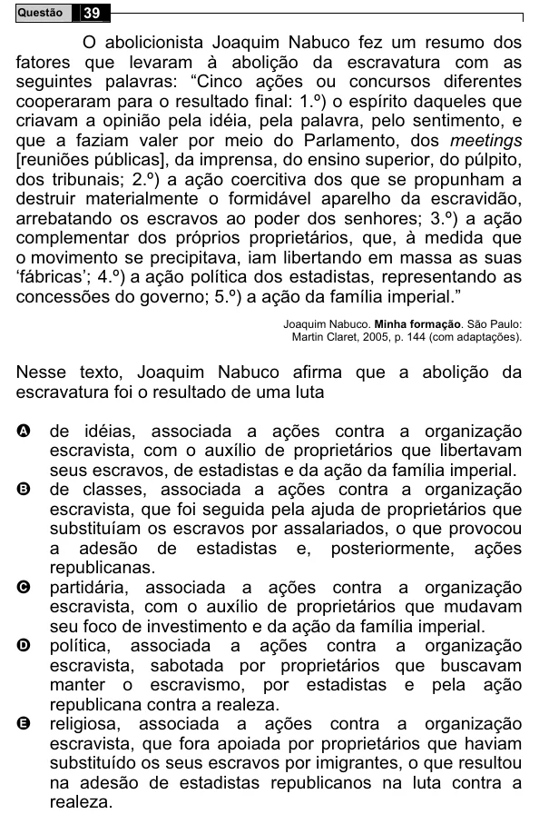

Texto extraído (pode conter ruído)

39  
Questão  
O abolicionista Joaquim Nabuco fez um resumo dos  
fatores que levaram à abolição da escravatura com as  
seguintes palavras: “Cinco ações ou concursos diferentes  
cooperaram para o resultado final: 1.º) o espírito daqueles que  
criavam a opinião pela idéia, pela palavra, pelo sentimento, e  
que a faziam valer por meio do Parlamento, dos meetings  
[reuniões públicas], da imprensa, do ensino superior, do púlpito,  
dos tribunais; 2.º) a ação coercitiva dos que se propunham a  
destruir materialmente o formidável aparelho da escravidão,  
arrebatando os escravos ao poder dos senhores; 3.º) a ação  
complementar dos próprios proprietários, que, à medida que  
o movimento se precipitava, iam libertando em massa as suas  
‘fábricas’; 4.º) a ação política dos estadistas, representando as  
concessões do governo; 5.º) a ação da família imperial.”  
Joaquim Nabuco. Minha formação. São Paulo:  
Martin Claret, 2005, p. 144 (com adaptações).  
Nesse texto, Joaquim Nabuco afirma que a abolição da  
escravatura foi o resultado de uma luta  
A  
de idéias, associada a ações contra a organização  
escravista, com o auxílio de proprietários que libertavam  
seus escravos, de estadistas e da ação da família imperial.  
B  
de classes, associada a ações contra a organização  
escravista, que foi seguida pela ajuda de proprietários que  
substituíam os escravos por assalariados, o que provocou  
a adesão de estadistas e, posteriormente, ações  
republicanas.  
partidária, associada a ações contra a organização  
C  
escravista, com o auxílio de proprietários que mudavam  
seu foco de investimento e da ação da família imperial.  
política, associada a ações contra a organização  
D  
escravista, sabotada por proprietários que buscavam  
manter o escravismo, por estadistas e pela ação  
republicana contra a realeza.  
religiosa, associada a ações contra a organização  
E  
escravista, que fora apoiada por proprietários que haviam  
substituído os seus escravos por imigrantes, o que resultou  
na adesão de estadistas republicanos na luta contra a  
realeza.

