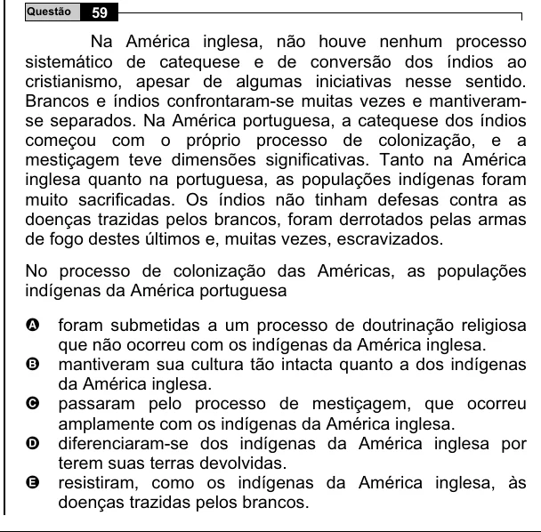

Texto extraído (pode conter ruído)

59  
Questão  
Na América inglesa, não houve nenhum processo  
sistemático de catequese e de conversão dos índios ao  
cristianismo, apesar de algumas iniciativas nesse sentido.  
Brancos e índios confrontaram-se muitas vezes e mantiveram-  
se separados. Na América portuguesa, a catequese dos índios  
começou com o próprio processo de colonização, e a  
mestiçagem teve dimensões significativas. Tanto na América  
inglesa quanto na portuguesa, as populações indígenas foram  
muito sacrificadas. Os índios não tinham defesas contra as  
doenças trazidas pelos brancos, foram derrotados pelas armas  
de fogo destes últimos e, muitas vezes, escravizados.  
No processo de colonização das Américas, as populações  
indígenas da América portuguesa  
foram submetidas a um processo de doutrinação religiosa  
A  
que não ocorreu com os indígenas da América inglesa.  
mantiveram sua cultura tão intacta quanto a dos indígenas  
B  
da América inglesa.  
C  
passaram pelo processo de mestiçagem, que ocorreu  
amplamente com os indígenas da América inglesa.  
D  
diferenciaram-se dos indígenas da América inglesa por  
terem suas terras devolvidas.  
E  
resistiram, como os indígenas da América inglesa, às  
doenças trazidas pelos brancos.

