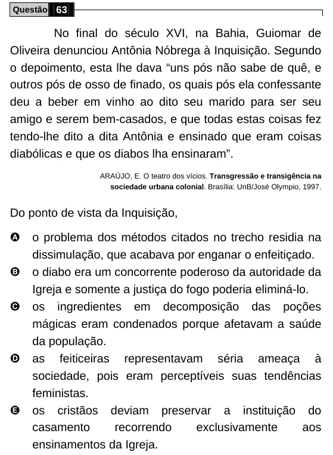

Texto extraído (pode conter ruído)

Questão 63  
No final do século XVI, na Bahia, Guiomar de  
Oliveira denunciou Antônia Nóbrega à Inquisição. Segundo  
o depoimento, esta lhe dava “uns pós não sabe de quê, e  
outros pós de osso de finado, os quais pós ela confessante  
deu a beber em vinho ao dito seu marido para ser seu  
amigo e serem bem-casados, e que todas estas coisas fez  
tendo-lhe dito a dita Antônia e ensinado que eram coisas  
diabólicas e que os diabos lha ensinaram”.  
ARAÚJO, E. O teatro dos vícios. Transgressão e transigência na  
sociedade urbana colonial. Brasília: UnB/José Olympio, 1997.  
Do ponto de vista da Inquisição,  
A  
o problema dos métodos citados no trecho residia na  
dissimulação, que acabava por enganar o enfeitiçado.  
B  
o diabo era um concorrente poderoso da autoridade da  
Igreja e somente a justiça do fogo poderia eliminá-lo.  
C  
os ingredientes em decomposição das poções  
mágicas eram condenados porque afetavam a saúde  
da população.  
D  
as feiticeiras representavam séria ameaça à  
sociedade, pois eram perceptíveis suas tendências  
feministas.  
E  
os cristãos deviam preservar a instituição do  
casamento  
recorrendo  
exclusivamente  
aos  
ensinamentos da Igreja.

