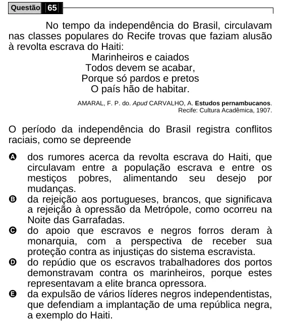

Texto extraído (pode conter ruído)

Questão 65  
No tempo da independência do Brasil, circulavam  
nas classes populares do Recife trovas que faziam alusão  
à revolta escrava do Haiti:  
Marinheiros e caiados  
Todos devem se acabar,  
Porque só pardos e pretos  
O país hão de habitar.  
AMARAL, F. P. do. Apud CARVALHO, A. Estudos pernambucanos.  
Recife: Cultura Acadêmica, 1907.  
O período da independência do Brasil registra conflitos  
raciais, como se depreende  
A  
dos rumores acerca da revolta escrava do Haiti, que  
circulavam entre a população escrava e entre os  
mestiços pobres, alimentando seu desejo por  
mudanças.  
B  
da rejeição aos portugueses, brancos, que significava  
a rejeição à opressão da Metrópole, como ocorreu na  
Noite das Garrafadas.  
C  
do apoio que escravos e negros forros deram à  
monarquia, com a perspectiva de receber sua  
proteção contra as injustiças do sistema escravista.  
D  
do repúdio que os escravos trabalhadores dos portos  
demonstravam contra os marinheiros, porque estes  
representavam a elite branca opressora.  
E  
da expulsão de vários líderes negros independentistas,  
que defendiam a implantação de uma república negra,  
a exemplo do Haiti.

