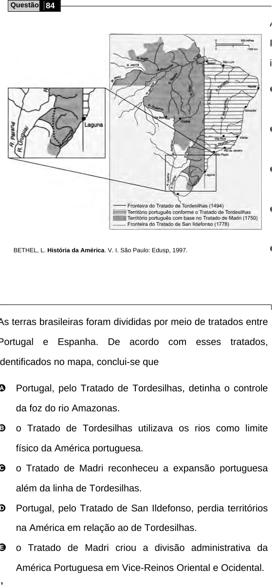

Texto extraído (pode conter ruído)

Questão 84  
As terras brasileiras foram divididas por meio de tratados entre  
Portugal e Espanha. De acordo com esses tratados,  
identificados no mapa, conclui-se que  
A  
B  
C  
D  
BETHEL, L. História da América. V. I. São Paulo: Edusp, 1997.  
E o Tratado de Madri criou a divisão administrativa da  
  
Portugal, pelo Tratado de Tordesilhas, detinha o controle  
da foz do rio Amazonas.  
o Tratado de Tordesilhas utilizava os rios como limite  
físico da América portuguesa.  
o Tratado de Madri reconheceu a expansão portuguesa  
além da linha de Tordesilhas.  
Portugal, pelo Tratado de San Ildefonso, perdia territórios  
na América em relação ao de Tordesilhas.  
América Portuguesa em Vice-Reinos Oriental e Ocidental.

