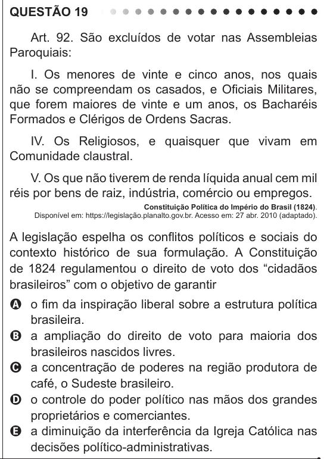

Texto extraído (pode conter ruído)

QUESTÃO 19  
Art. 92. São excluídos de votar nas Assembleias  
Paroquiais:  
I. Os menores de vinte e cinco anos, nos quais  
não se compreendam os casados, e Oficiais Militares,  
que forem maiores de vinte e um anos, os Bacharéis  
Formados e Clérigos de Ordens Sacras.  
IV. Os Religiosos, e quaisquer que vivam em  
Comunidade claustral.  
V. Os que não tiverem de renda líquida anual cem mil  
réis por bens de raiz, indústria, comércio ou empregos.  
Constituição Política do Império do Brasil (1824).  
Disponível em: https://legislação.planalto.gov.br. Acesso em: 27 abr. 2010 (adaptado).  
A legislação espelha os conflitos políticos e sociais do  
contexto histórico de sua formulação. A Constituição  
de 1824 regulamentou o direito de voto dos “cidadãos  
brasileiros” com o objetivo de garantir  
A o fim da inspiração liberal sobre a estrutura política  
brasileira.  
B a ampliação do direito de voto para maioria dos  
brasileiros nascidos livres.  
C a concentração de poderes na região produtora de  
café, o Sudeste brasileiro.  
D o controle do poder político nas mãos dos grandes  
proprietários e comerciantes.  
E a diminuição da interferência da Igreja Católica nas  
decisões político-administrativas.

