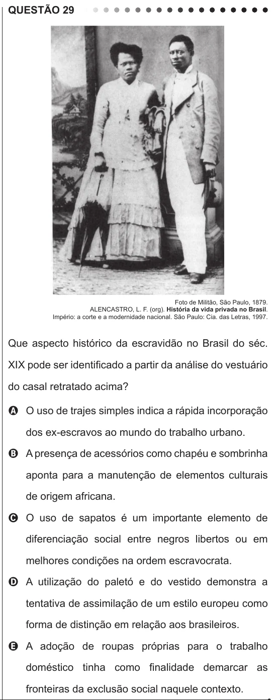

Texto extraído (pode conter ruído)

QUESTÃO 29  
Foto de Militão, São Paulo, 1879.  
ALENCASTRO, L. F. (org). História da vida privada no Brasil.  
Império: a corte e a modernidade nacional. São Paulo: Cia. das Letras, 1997.  
Que aspecto histórico da escravidão no Brasil do séc.  
XIX pode ser identificado a partir da análise do vestuário  
do casal retratado acima?  
A O uso de trajes simples indica a rápida incorporação  
dos ex-escravos ao mundo do trabalho urbano.  
B A presença de acessórios como chapéu e sombrinha  
aponta para a manutenção de elementos culturais  
de origem africana.  
C O uso de sapatos é um importante elemento de  
diferenciação social entre negros libertos ou em  
melhores condições na ordem escravocrata.  
D A utilização do paletó e do vestido demonstra a  
tentativa de assimilação de um estilo europeu como  
forma de distinção em relação aos brasileiros.  
E A adoção de roupas próprias para o trabalho  
doméstico tinha como finalidade demarcar as  
fronteiras da exclusão social naquele contexto.

