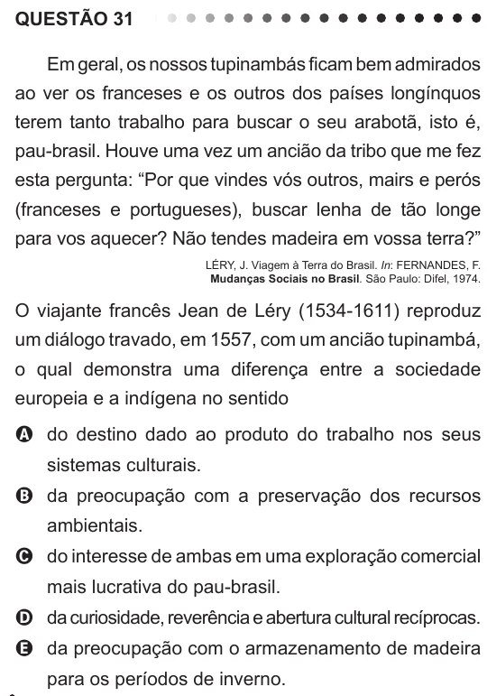

Texto extraído (pode conter ruído)

QUESTÃO 31  
Em geral, os nossos tupinambás ficam bem admirados  
ao ver os franceses e os outros dos países longínquos  
terem tanto trabalho para buscar o seu arabotã, isto é,  
pau-brasil. Houve uma vez um ancião da tribo que me fez  
esta pergunta: “Por que vindes vós outros, mairs e perós  
(franceses e portugueses), buscar lenha de tão longe  
para vos aquecer? Não tendes madeira em vossa terra?”  
LÉRY, J. Viagem à Terra do Brasil. In: FERNANDES, F.  
Mudanças Sociais no Brasil. São Paulo: Difel, 1974.  
O viajante francês Jean de Léry (1534-1611) reproduz  
um diálogo travado, em 1557, com um ancião tupinambá,  
o qual demonstra uma diferença entre a sociedade  
europeia e a indígena no sentido  
A do destino dado ao produto do trabalho nos seus  
sistemas culturais.  
B da preocupação com a preservação dos recursos  
ambientais.  
C do interesse de ambas em uma exploração comercial  
mais lucrativa do pau-brasil.  
D da curiosidade, reverência e abertura cultural recíprocas.  
E da preocupação com o armazenamento de madeira  
para os períodos de inverno.

