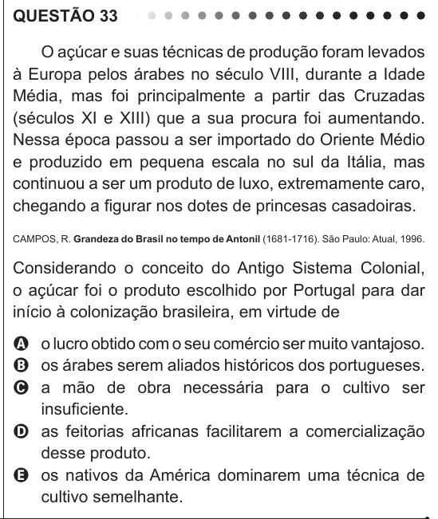

Texto extraído (pode conter ruído)

QUESTÃO 33  
O açúcar e suas técnicas de produção foram levados  
à Europa pelos árabes no século VIII, durante a Idade  
Média, mas foi principalmente a partir das Cruzadas  
(séculos XI e XIII) que a sua procura foi aumentando.  
Nessa época passou a ser importado do Oriente Médio  
e produzido em pequena escala no sul da Itália, mas  
continuou a ser um produto de luxo, extremamente caro,  
chegando a figurar nos dotes de princesas casadoiras.  
CAMPOS, R. Grandeza do Brasil no tempo de Antonil (1681-1716). São Paulo: Atual, 1996.  
Considerando o conceito do Antigo Sistema Colonial,  
o açúcar foi o produto escolhido por Portugal para dar  
início à colonização brasileira, em virtude de  
A o lucro obtido com o seu comércio ser muito vantajoso.  
B os árabes serem aliados históricos dos portugueses.  
C a mão de obra necessária para o cultivo ser  
insuficiente.  
D as feitorias africanas facilitarem a comercialização  
desse produto.  
E os nativos da América dominarem uma técnica de  
cultivo semelhante.

