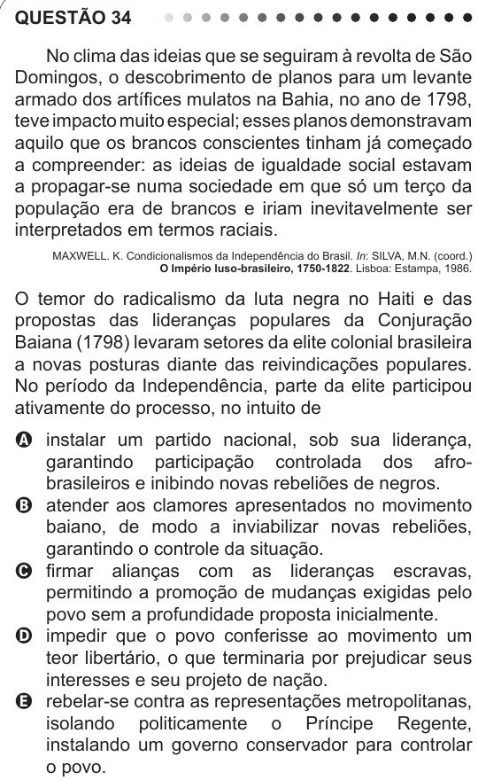

Texto extraído (pode conter ruído)

QUESTÃO 34  
No clima das ideias que se seguiram à revolta de São  
Domingos, o descobrimento de planos para um levante  
armado dos artífices mulatos na Bahia, no ano de 1798,  
teve impacto muito especial; esses planos demonstravam  
aquilo que os brancos conscientes tinham já começado  
a compreender: as ideias de igualdade social estavam  
a propagar-se numa sociedade em que só um terço da  
população era de brancos e iriam inevitavelmente ser  
interpretados em termos raciais.  
MAXWELL. K. Condicionalismos da Independência do Brasil. In: SILVA, M.N. (coord.)  
O Império luso-brasileiro, 1750-1822. Lisboa: Estampa, 1986.  
O temor do radicalismo da luta negra no Haiti e das  
propostas das lideranças populares da Conjuração  
Baiana (1798) levaram setores da elite colonial brasileira  
a novas posturas diante das reivindicações populares.  
No período da Independência, parte da elite participou  
ativamente do processo, no intuito de  
A instalar um partido nacional, sob sua liderança,  
garantindo participação controlada dos afro-  
brasileiros e inibindo novas rebeliões de negros.  
B atender aos clamores apresentados no movimento  
baiano, de modo a inviabilizar novas rebeliões,  
garantindo o controle da situação.  
C firmar alianças com as lideranças escravas,  
permitindo a promoção de mudanças exigidas pelo  
povo sem a profundidade proposta inicialmente.  
D impedir que o povo conferisse ao movimento um  
teor libertário, o que terminaria por prejudicar seus  
interesses e seu projeto de nação.  
E rebelar-se contra as representações metropolitanas,  
isolando politicamente o Príncipe Regente,  
instalando um governo conservador para controlar  
o povo.

