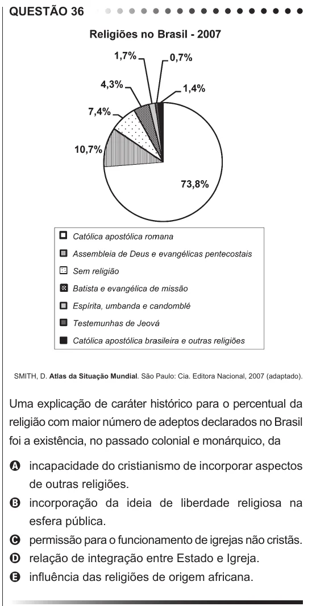

Texto extraído (pode conter ruído)

QUESTÃO 36  
SMITH, D. Atlas da Situação Mundial. São Paulo: Cia. Editora Nacional, 2007 (adaptado).  
Uma explicação de caráter histórico para o percentual da  
religião com maior número de adeptos declarados no Brasil  
foi a existência, no passado colonial e monárquico, da  
A incapacidade do cristianismo de incorporar aspectos  
de outras religiões.  
B incorporação da ideia de liberdade religiosa na  
esfera pública.  
C permissão para o funcionamento de igrejas não cristãs.  
D relação de integração entre Estado e Igreja.  
E influência das religiões de origem africana.

