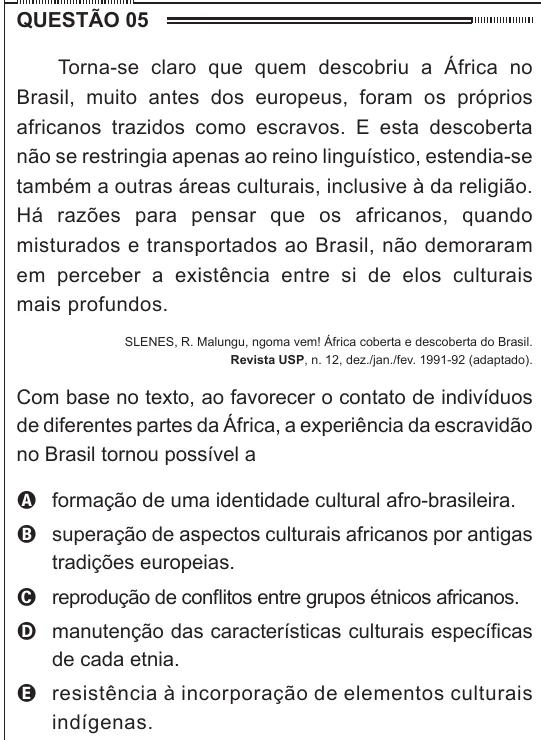

Texto extraído (pode conter ruído)

QUESTÃO 05  
Torna-se claro que quem descobriu a África no  
Brasil, muito antes dos europeus, foram os próprios  
africanos trazidos como escravos. E esta descoberta  
não se restringia apenas ao reino linguístico, estendia-se  
também a outras áreas culturais, inclusive à da religião.  
Há razões para pensar que os africanos, quando  
misturados e transportados ao Brasil, não demoraram  
em perceber a existência entre si de elos culturais  
mais profundos.  
SLENES, R. Malungu, ngoma vem! África coberta e descoberta do Brasil.  
Revista USP, n. 12, dez./jan./fev. 1991-92 (adaptado).  
Com base no texto, ao favorecer o contato de indivíduos  
de diferentes partes da África, a experiência da escravidão  
no Brasil tornou possível a  
A formação de uma identidade cultural afro-brasileira.  
B superação de aspectos culturais africanos por antigas  
tradições europeias.  
C reprodução de conflitos entre grupos étnicos africanos.  
D manutenção das características culturais específicas  
de cada etnia.  
E resistência à incorporação de elementos culturais  
indígenas.

