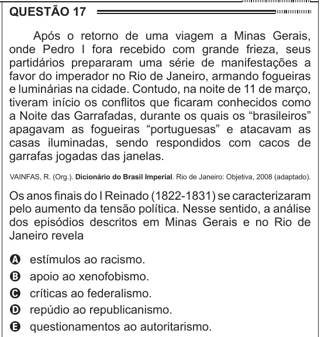

Texto extraído (pode conter ruído)

QUESTÃO 17  
Após o retorno de uma viagem a Minas Gerais,  
onde Pedro I fora recebido com grande frieza, seus  
partidários prepararam uma série de manifestações a  
favor do imperador no Rio de Janeiro, armando fogueiras  
e luminárias na cidade. Contudo, na noite de 11 de março,  
tiveram início os conflitos que ficaram conhecidos como  
a Noite das Garrafadas, durante os quais os “brasileiros”  
apagavam as fogueiras “portuguesas” e atacavam as  
casas iluminadas, sendo respondidos com cacos de  
garrafas jogadas das janelas.  
VAINFAS, R. (Org.). Dicionário do Brasil Imperial. Rio de Janeiro: Objetiva, 2008 (adaptado).  
Os anos finais do I Reinado (1822-1831) se caracterizaram  
pelo aumento da tensão política. Nesse sentido, a análise  
dos episódios descritos em Minas Gerais e no Rio de  
Janeiro revela  
estímulos ao racismo.  
A  
B  
apoio ao xenofobismo.  
críticas ao federalismo.  
C  
D  
repúdio ao republicanismo.  
questionamentos ao autoritarismo.  
E

