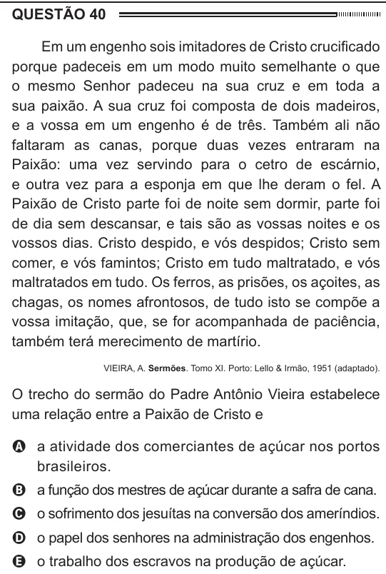

Texto extraído (pode conter ruído)

QUESTÃO 40  
Em um engenho sois imitadores de Cristo crucificado  
porque padeceis em um modo muito semelhante o que  
o mesmo Senhor padeceu na sua cruz e em toda a  
sua paixão. A sua cruz foi composta de dois madeiros,  
e a vossa em um engenho é de três. Também ali não  
faltaram as canas, porque duas vezes entraram na  
Paixão: uma vez servindo para o cetro de escárnio,  
e outra vez para a esponja em que lhe deram o fel. A  
Paixão de Cristo parte foi de noite sem dormir, parte foi  
de dia sem descansar, e tais são as vossas noites e os  
vossos dias. Cristo despido, e vós despidos; Cristo sem  
comer, e vós famintos; Cristo em tudo maltratado, e vós  
maltratados em tudo. Os ferros, as prisões, os açoites, as  
chagas, os nomes afrontosos, de tudo isto se compõe a  
vossa imitação, que, se for acompanhada de paciência,  
também terá merecimento de martírio.  
VIEIRA, A. Sermões. Tomo XI. Porto: Lello & Irmão, 1951 (adaptado).  
O trecho do sermão do Padre Antônio Vieira estabelece  
uma relação entre a Paixão de Cristo e  
A a atividade dos comerciantes de açúcar nos portos  
brasileiros.  
B a função dos mestres de açúcar durante a safra de cana.  
C o sofrimento dos jesuítas na conversão dos ameríndios.  
D o papel dos senhores na administração dos engenhos.  
E o trabalho dos escravos na produção de açúcar.

