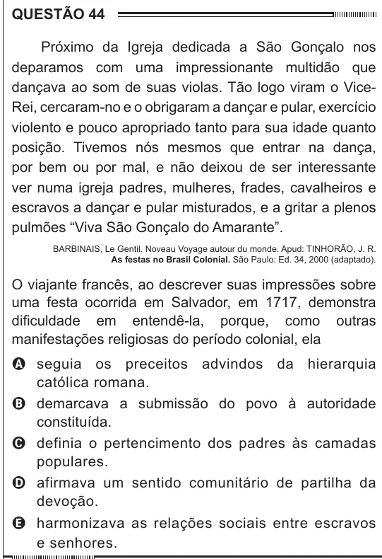

Texto extraído (pode conter ruído)

QUESTÃO 44  
Próximo da Igreja dedicada a São Gonçalo nos  
deparamos com uma impressionante multidão que  
dançava ao som de suas violas. Tão logo viram o Vice-  
Rei, cercaram-no e o obrigaram a dançar e pular, exercício  
violento e pouco apropriado tanto para sua idade quanto  
posição. Tivemos nós mesmos que entrar na dança,  
por bem ou por mal, e não deixou de ser interessante  
ver numa igreja padres, mulheres, frades, cavalheiros e  
escravos a dançar e pular misturados, e a gritar a plenos  
pulmões “Viva São Gonçalo do Amarante”.  
Barbinais, Le Gentil. Noveau Voyage autour du monde. Apud: TINHORÃO, J. R.  
As festas no Brasil Colonial. São Paulo: Ed. 34, 2000 (adaptado).  
O viajante francês, ao descrever suas impressões sobre  
uma festa ocorrida em Salvador, em 1717, demonstra  
dificuldade em entendê-la, porque, como outras  
manifestações religiosas do período colonial, ela  
A seguia os preceitos advindos da hierarquia  
católica romana.  
B demarcava a submissão do povo à autoridade  
constituída.  
C definia o pertencimento dos padres às camadas  
populares.  
D afirmava um sentido comunitário de partilha da  
devoção.  
E harmonizava as relações sociais entre escravos  
e senhores.

