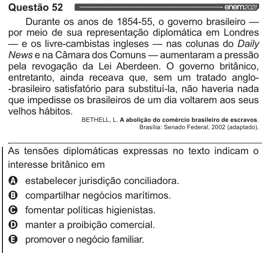

Texto extraído (pode conter ruído)

Questão 52  
Durante os anos de 1854-55, o governo brasileiro —  
por meio de sua representação diplomática em Londres  
— e os livre-cambistas ingleses — nas colunas do Daily  
News e na Câmara dos Comuns — aumentaram a pressão  
pela revogação da Lei Aberdeen. O governo britânico,  
entretanto, ainda receava que, sem um tratado anglo-  
“brasileiro satisfatório para substituí-la, não haveria nada  
que impedisse os brasileiros de um dia voltarem aos seus  
velhos hábitos.  
BETHELL, L. A abolição do comércio brasileiro de escravos.  
Brasília: Senado Federal, 2002 (adaptado).  
As tensões diplomáticas expressas no texto indicam o  
interesse britânico em  
Q estabelecer jurisdição conciliadora.  
O compartilhar negócios marítimos.  
O fomentar políticas higienistas.  
O manter a proibição comercial.  
& promover o negócio familiar.

