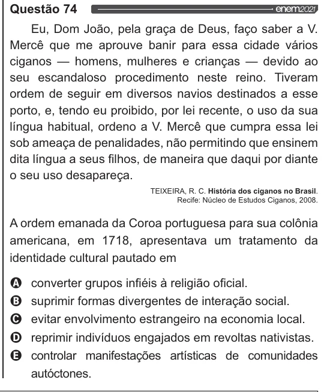

Texto extraído (pode conter ruído)

Questão 74  
Eu, Dom João, pela graça de Deus, faço saber a V.  
Mercê que me aprouve banir para essa cidade vários  
ciganos — homens, mulheres e crianças — devido ao  
seu escandaloso procedimento neste reino. Tiveram  
ordem de seguir em diversos navios destinados a esse  
porto, e, tendo eu proibido, por lei recente, o uso da sua  
língua habitual, ordeno a V. Mercê que cumpra essa lei  
sob ameaça de penalidades, não permitindo que ensinem  
dita língua a seus filhos, de maneira que daqui por diante  
o seu uso desapareça.  
TEIXEIRA, R. C. História dos ciganos no Brasil.  
Recife: Núcleo de Estudos Ciganos, 2008.  
A ordem emanada da Coroa portuguesa para sua colônia  
americana, em 1718, apresentava um tratamento da  
identidade cultural pautado em  
Q converter grupos infiéis à religião oficial.  
VOO  
suprimir formas divergentes de interação social.  
evitar envolvimento estrangeiro na economia local.  
reprimir indivíduos engajados em revoltas nativistas.  
controlar manifestações artísticas de comunidades  
autóctones.

