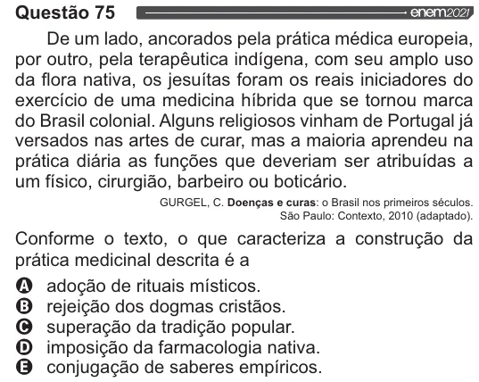

Texto extraído (pode conter ruído)

Questão 75  
De um lado, ancorados pela prática médica europeia,  
por outro, pela terapêutica indígena, com seu amplo uso  
da flora nativa, os jesuítas foram os reais iniciadores do  
exercício de uma medicina híbrida que se tornou marca  
do Brasil colonial. Alguns religiosos vinham de Portugal já  
versados nas artes de curar, mas a maioria aprendeu na  
prática diária as funções que deveriam ser atribuídas a  
um físico, cirurgião, barbeiro ou boticário.  
GURGEL, C. Doenças e curas: o Brasil nos primeiros séculos.  
São Paulo: Contexto, 2010 (adaptado).  
Conforme o texto, o que caracteriza a construção da  
prática medicinal descrita é a  
VOVOO  
adoção de rituais místicos.  
rejeição dos dogmas cristãos.  
superação da tradição popular.  
imposição da farmacologia nativa.  
conjugação de saberes empíricos.

