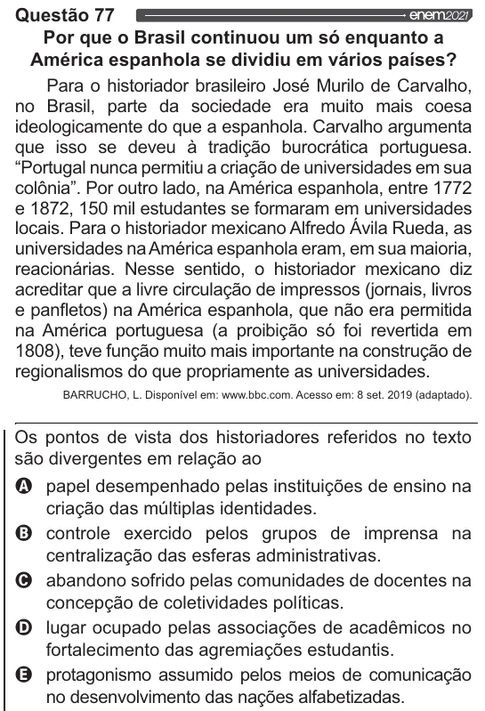

Texto extraído (pode conter ruído)

Por que o Brasil continuou um só enquanto a  
América espanhola se dividiu em vários países?  
Para o historiador brasileiro José Murilo de Carvalho,  
no Brasil, parte da sociedade era muito mais coesa  
ideologicamente do que a espanhola. Carvalho argumenta  
que isso se deveu à tradição burocrática portuguesa.  
“Portugal nunca permitiu a criação de universidades em sua  
colônia”. Por outro lado, na América espanhola, entre 1772  
e 1872, 150 mil estudantes se formaram em universidades  
locais. Para o historiador mexicano Alfredo Ávila Rueda, as  
universidades na América espanhola eram, em sua maioria,  
reacionárias. Nesse sentido, o historiador mexicano diz  
acreditar que a livre circulação de impressos (jornais, livros  
e panfletos) na América espanhola, que não era permitida  
na América portuguesa (a proibição só foi revertida em  
1808), teve função muito mais importante na construção de  
regionalismos do que propriamente as universidades.  
BARRUCHO, L. Disponivel em: www.bbc.com. Acesso em: 8 set. 2019 (adaptado).  
Os pontos de vista dos historiadores referidos no texto  
são divergentes em relação ao  
Q papel desempenhado pelas instituições de ensino na  
criação das múltiplas identidades.  
Oo o o  
controle exercido pelos grupos de imprensa na  
centralização das esferas administrativas.  
abandono sofrido pelas comunidades de docentes na  
concepção de coletividades políticas.  
lugar ocupado pelas associações de acadêmicos no  
fortalecimento das agremiações estudantis.  
& protagonismo assumido pelos meios de comunicação  
no desenvolvimento das nações alfabetizadas.

