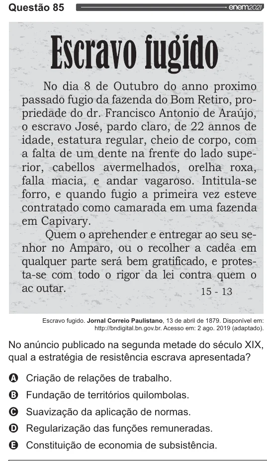

Texto extraído (pode conter ruído)

Questão 85  
Escravo Íugido  
No dia 8 de Outubro do anno proximo  
passado fugio da fazenda do Bom Retiro, pro-  
priedade do dr. Francisco Antonio de Araújo,  
o escravo José, pardo claro, de 22 annos de  
idade, estatura regular, cheio de corpo, com  
a falta de um dente na frente do lado supe-  
rior, cabellos avermelhados, orelha roxa,  
falla macia, e andar vagaroso. Intitula-se  
forro, e quando fugio a primeira vez esteve  
contratado como camarada em uma fazenda  
em Capivary.  
Quem o aprehender e entregar ao seu se-  
nhor no Amparo, ou o recolher a cadêa em  
qualquer parte será bem gratificado, e protes-  
ta-se com todo o rigor da lei contra quem o  
ac outar. 15-13  
Escravo fugido. Jornal Correio Paulistano, 13 de abril de 1879. Disponível em:  
http://bndigital.bn.gov.br. Acesso em: 2 ago. 2019 (adaptado).  
No anúncio publicado na segunda metade do século XIX,  
qual a estratégia de resistência escrava apresentada?  
VOVOO  
Criação de relações de trabalho.  
Fundação de territórios quilombolas.  
Suavização da aplicação de normas.  
Regularização das funções remuneradas.  
Constituição de economia de subsistência.

