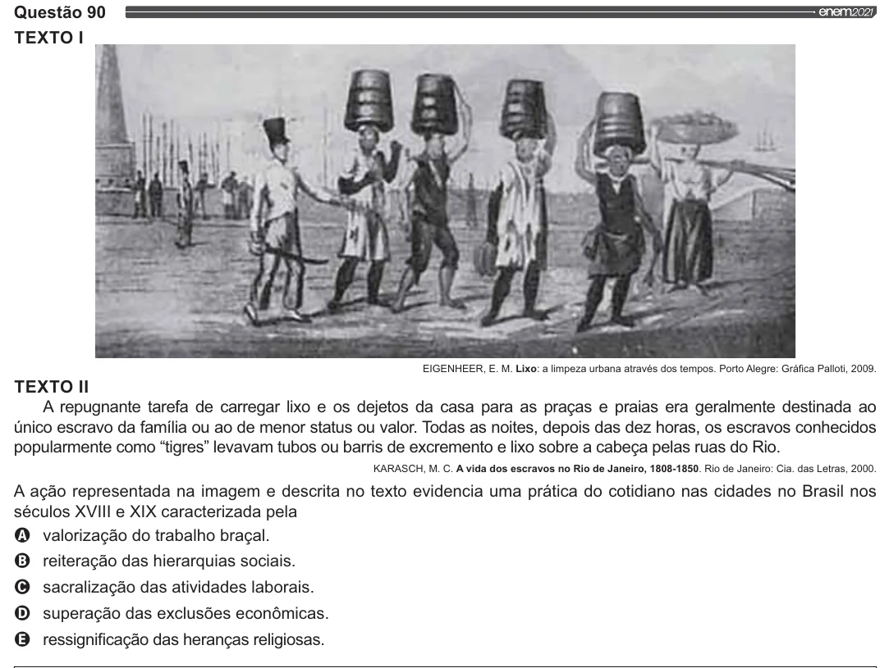

Texto extraído (pode conter ruído)

Questão 90  
TEXTO |.  
EIGENHEER, E. M. Lixo: a limpeza urbana através dos tempos. Porto Alegre: Gráfica Palloti, 2009.  
TEXTO II  
A repugnante tarefa de carregar lixo e os dejetos da casa para as praças e praias era geralmente destinada ao  
único escravo da família ou ao de menor status ou valor. Todas as noites, depois das dez horas, os escravos conhecidos  
popularmente como “tigres” levavam tubos ou barris de excremento e lixo sobre a cabeça pelas ruas do Rio.  
KARASCH, M. C. A vida dos escravos no Rio de Janeiro, 1808-1850. Rio de Janeiro: Cia. das Letras, 2000.  
A ação representada na imagem e descrita no texto evidencia uma prática do cotidiano nas cidades no Brasil nos  
séculos XVIIl e XIX caracterizada pela  
VOO  
valorização do trabalho braçal.  
reiteração das hierarquias sociais.  
sacralização das atividades laborais.  
superação das exclusões econômicas.  
ressignificação das heranças religiosas.

