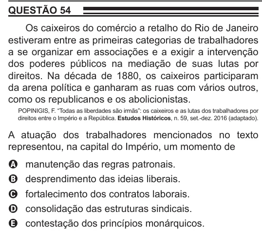

Texto extraído (pode conter ruído)

QUESTÃO 54  
Os caixeiros do comércio a retalho do Rio de Janeiro  
estiveram entre as primeiras categorias de trabalhadores  
a se organizar em associações e a exigir a intervenção  
dos poderes públicos na mediação de suas lutas por  
direitos. Na década de 1880, os caixeiros participaram  
da arena política e ganharam as ruas com vários outros,  
como os republicanos e os abolicionistas.  
POPINIGIS, F. “Todas as liberdades são irmãs”: os caixeiros e as lutas dos trabalhadores por  
direitos entre o Império e a República. Estudos Históricos, n. 59, set.-dez. 2016 (adaptado).  
A atuação dos trabalhadores mencionados no texto  
representou, na capital do Império, um momento de  
manutenção das regras patronais.  
A  
desprendimento das ideias liberais.  
B  
fortalecimento dos contratos laborais.  
C  
D  
consolidação das estruturas sindicais.  
contestação dos princípios monárquicos.  
E

