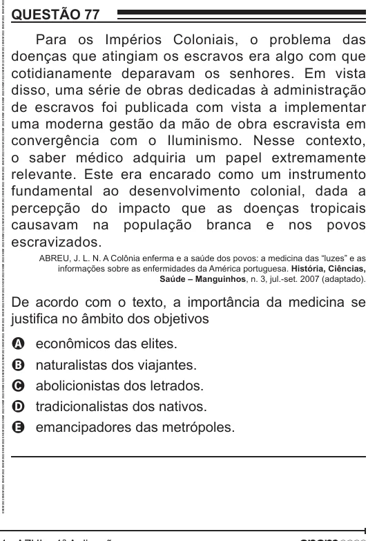

Texto extraído (pode conter ruído)

QUESTÃO 77  
Para os Impérios Coloniais, o problema das  
doenças que atingiam os escravos era algo com que  
cotidianamente deparavam os senhores. Em vista  
disso, uma série de obras dedicadas à administração  
de escravos foi publicada com vista a implementar  
uma moderna gestão da mão de obra escravista em  
convergência com o Iluminismo. Nesse contexto,  
o saber médico adquiria um papel extremamente  
relevante. Este era encarado como um instrumento  
fundamental ao desenvolvimento colonial, dada a  
percepção do impacto que as doenças tropicais  
causavam na população branca e nos povos  
escravizados.  
ABREU, J. L. N. A Colônia enferma e a saúde dos povos: a medicina das “luzes” e as  
informações sobre as enfermidades da América portuguesa. História, Ciências,  
Saúde – Manguinhos, n. 3, jul.-set. 2007 (adaptado).  
De acordo com o texto, a importância da medicina se  
justifica no âmbito dos objetivos  
econômicos das elites.  
A  
B  
naturalistas dos viajantes.  
abolicionistas dos letrados.  
C  
tradicionalistas dos nativos.  
D  
emancipadores das metrópoles.  
E

