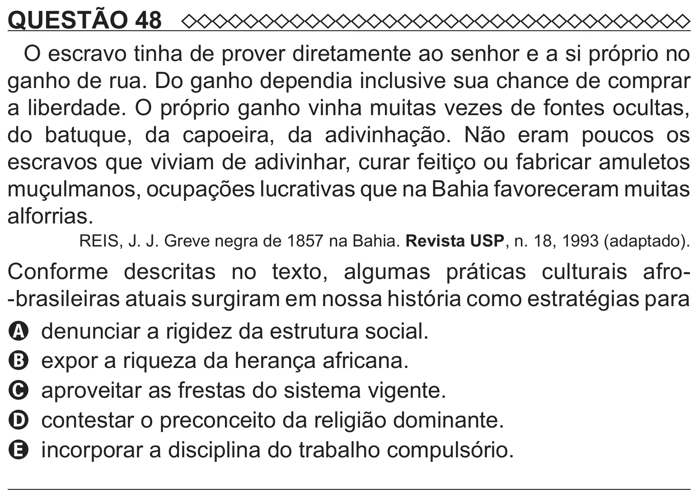

Texto extraído (pode conter ruído)

QUESTÃO 48  
O escravo tinha de prover diretamente ao senhor e a si próprio no  
ganho de rua. Do ganho dependia inclusive sua chance de comprar  
a liberdade. O próprio ganho vinha muitas vezes de fontes ocultas,  
do batuque, da capoeira, da adivinhação. Não eram poucos os  
escravos que viviam de adivinhar, curar feitiço ou fabricar amuletos  
muçulmanos, ocupações lucrativas que na Bahia favoreceram muitas  
alforrias.  
REIS, J. J. Greve negra de 1857 na Bahia. Revista USP, n. 18, 1993 (adaptado).  
Conforme descritas no texto, algumas práticas culturais afro-  
-brasileiras atuais surgiram em nossa história como estratégias para  
A denunciar a rigidez da estrutura social.  
B expor a riqueza da herança africana.  
C aproveitar as frestas do sistema vigente.  
D contestar o preconceito da religião dominante.  
E incorporar a disciplina do trabalho compulsório.

