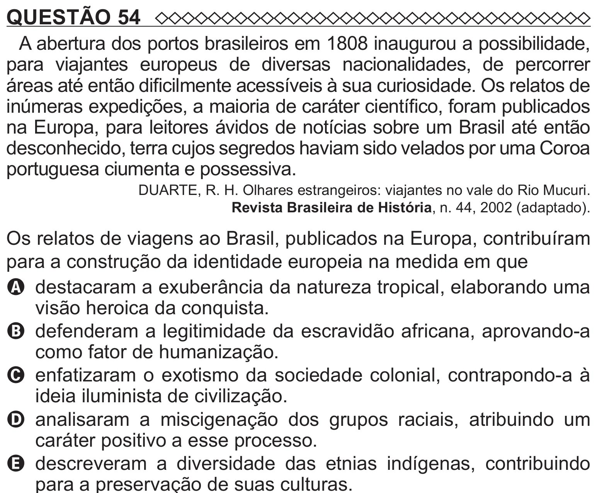

Texto extraído (pode conter ruído)

QUESTÃO 54  
A abertura dos portos brasileiros em 1808 inaugurou a possibilidade,  
para viajantes europeus de diversas nacionalidades, de percorrer  
áreas até então dificilmente acessíveis à sua curiosidade. Os relatos de  
inúmeras expedições, a maioria de caráter científico, foram publicados  
na Europa, para leitores ávidos de notícias sobre um Brasil até então  
desconhecido, terra cujos segredos haviam sido velados por uma Coroa  
portuguesa ciumenta e possessiva.  
DUARTE, R. H. Olhares estrangeiros: viajantes no vale do Rio Mucuri.  
Revista Brasileira de História, n. 44, 2002 (adaptado).  
Os relatos de viagens ao Brasil, publicados na Europa, contribuíram  
para a construção da identidade europeia na medida em que  
A destacaram a exuberância da natureza tropical, elaborando uma  
visão heroica da conquista.  
B defenderam a legitimidade da escravidão africana, aprovando-a  
como fator de humanização.  
C enfatizaram o exotismo da sociedade colonial, contrapondo-a à  
ideia iluminista de civilização.  
D   
analisaram a miscigenação dos grupos raciais, atribuindo um  
caráter positivo a esse processo.  
E descreveram a diversidade das etnias indígenas, contribuindo

