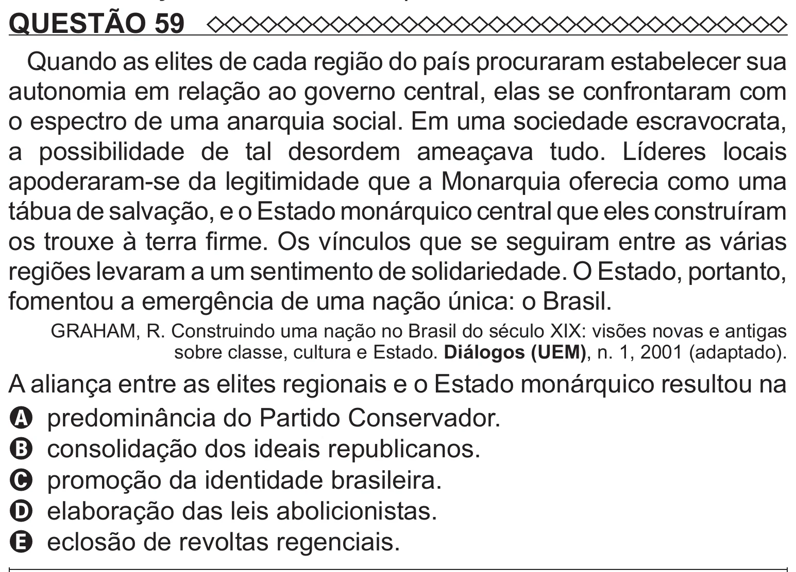

Texto extraído (pode conter ruído)

QUESTÃO 59  
Quando as elites de cada região do país procuraram estabelecer sua  
autonomia em relação ao governo central, elas se confrontaram com  
o espectro de uma anarquia social. Em uma sociedade escravocrata,  
a possibilidade de tal desordem ameaçava tudo. Líderes locais  
apoderaram-se da legitimidade que a Monarquia oferecia como uma  
tábua de salvação, e o Estado monárquico central que eles construíram  
os trouxe à terra firme. Os vínculos que se seguiram entre as várias  
regiões levaram a um sentimento de solidariedade. O Estado, portanto,  
fomentou a emergência de uma nação única: o Brasil.  
GRAHAM, R. Construindo uma nação no Brasil do século XIX: visões novas e antigas  
sobre classe, cultura e Estado. Diálogos (UEM), n. 1, 2001 (adaptado).  
A aliança entre as elites regionais e o Estado monárquico resultou na  
A predominância do Partido Conservador.  
B consolidação dos ideais republicanos.  
C promoção da identidade brasileira.  
D elaboração das leis abolicionistas.  
E eclosão de revoltas regenciais.

