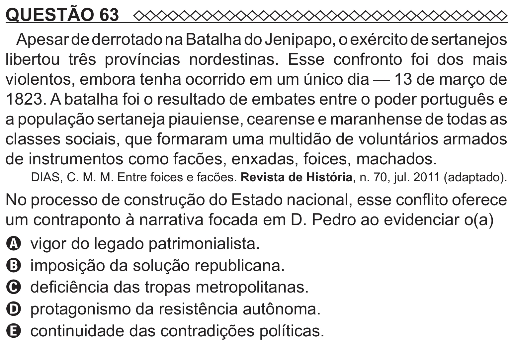

Texto extraído (pode conter ruído)

QUESTÃO 63  
Apesar de derrotado na Batalha do Jenipapo, o exército de sertanejos  
libertou três províncias nordestinas. Esse confronto foi dos mais  
violentos, embora tenha ocorrido em um único dia — 13 de março de  
1823. A batalha foi o resultado de embates entre o poder português e  
a população sertaneja piauiense, cearense e maranhense de todas as  
classes sociais, que formaram uma multidão de voluntários armados  
de instrumentos como facões, enxadas, foices, machados.  
DIAS, C. M. M. Entre foices e facões. Revista de História, n. 70, jul. 2011 (adaptado).  
No processo de construção do Estado nacional, esse conflito oferece  
um contraponto à narrativa focada em D. Pedro ao evidenciar o(a)  
A vigor do legado patrimonialista.  
B imposição da solução republicana.  
C deficiência das tropas metropolitanas.  
D protagonismo da resistência autônoma.  
E continuidade das contradições políticas.

