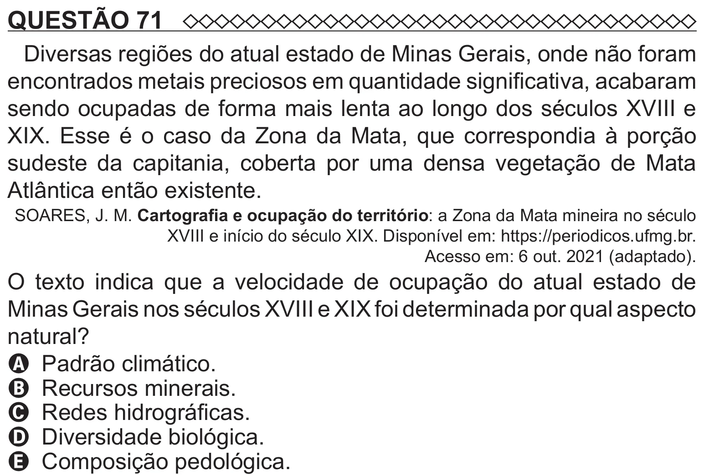

Texto extraído (pode conter ruído)

QUESTÃO 71  
Diversas regiões do atual estado de Minas Gerais, onde não foram  
encontrados metais preciosos em quantidade significativa, acabaram  
sendo ocupadas de forma mais lenta ao longo dos séculos XVIII e  
XIX. Esse é o caso da Zona da Mata, que correspondia à porção  
sudeste da capitania, coberta por uma densa vegetação de Mata  
Atlântica então existente.  
SOARES, J. M. Cartografia e ocupação do território: a Zona da Mata mineira no século  
XVIII e início do século XIX. Disponível em: https://periodicos.ufmg.br.  
Acesso em: 6 out. 2021 (adaptado).  
O texto indica que a velocidade de ocupação do atual estado de  
Minas Gerais nos séculos XVIII e XIX foi determinada por qual aspecto  
natural?  
A Padrão climático.  
B Recursos minerais.  
C Redes hidrográficas.  
D Diversidade biológica.

