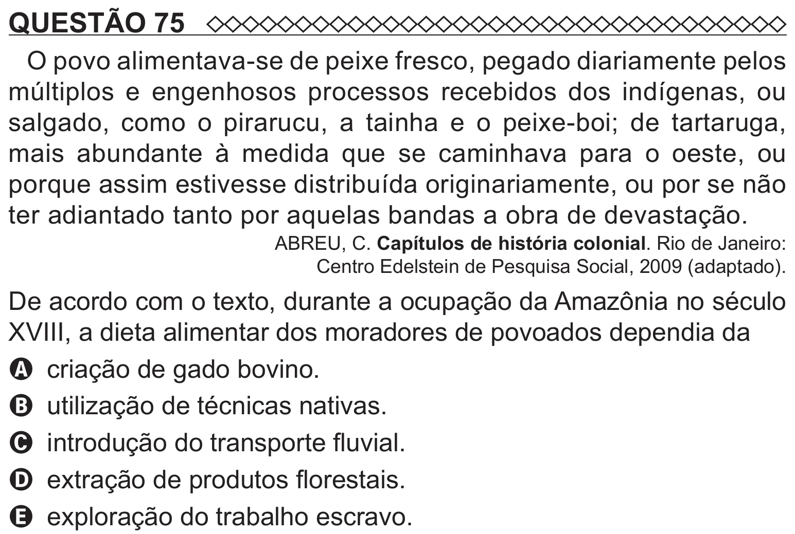

Texto extraído (pode conter ruído)

QUESTÃO 75  
O povo alimentava-se de peixe fresco, pegado diariamente pelos  
múltiplos e engenhosos processos recebidos dos indígenas, ou  
salgado, como o pirarucu, a tainha e o peixe-boi; de tartaruga,  
mais abundante à medida que se caminhava para o oeste, ou  
porque assim estivesse distribuída originariamente, ou por se não  
ter adiantado tanto por aquelas bandas a obra de devastação.  
ABREU, C. Capítulos de história colonial. Rio de Janeiro:  
Centro Edelstein de Pesquisa Social, 2009 (adaptado).  
De acordo com o texto, durante a ocupação da Amazônia no século  
XVIII, a dieta alimentar dos moradores de povoados dependia da  
A criação de gado bovino.  
B utilização de técnicas nativas.  
C introdução do transporte fluvial.  
D extração de produtos florestais.  
E exploração do trabalho escravo.

