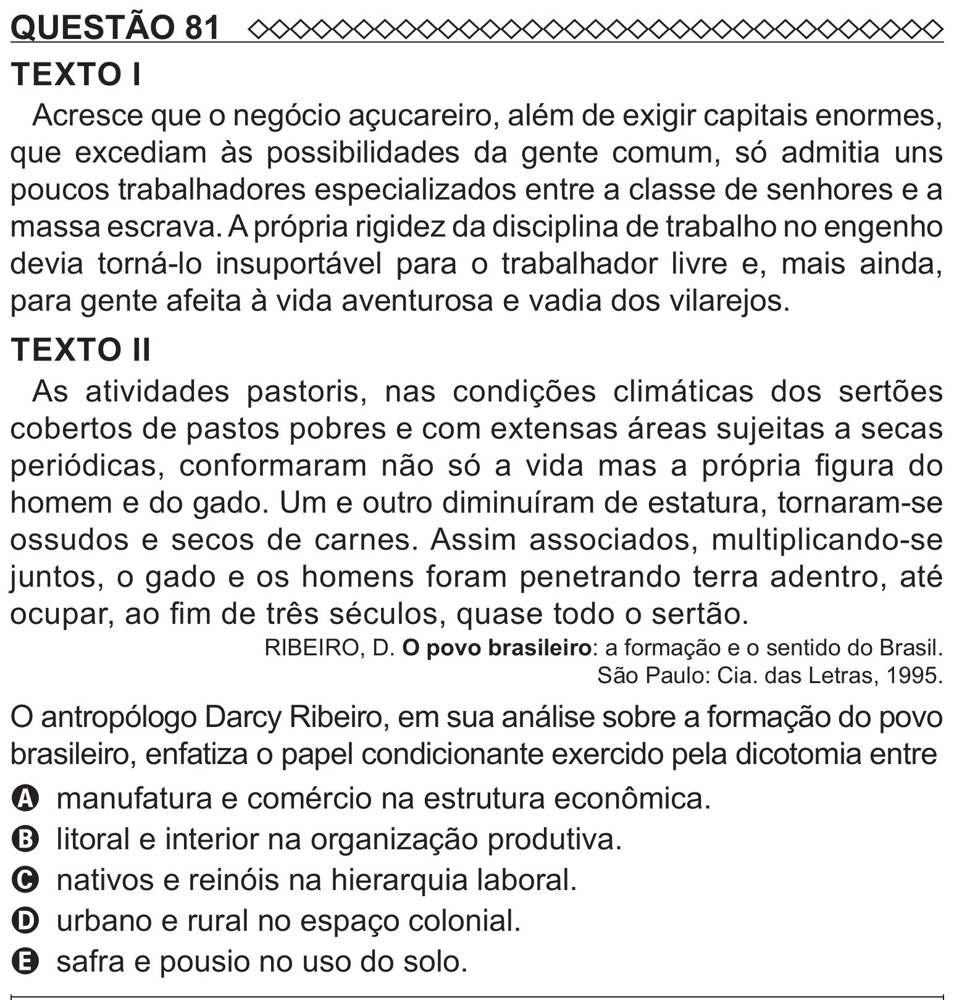

Texto extraído (pode conter ruído)

QUESTÃO 81  
TEXTO I  
Acresce que o negócio açucareiro, além de exigir capitais enormes,  
que excediam às possibilidades da gente comum, só admitia uns  
poucos trabalhadores especializados entre a classe de senhores e a  
massa escrava. A própria rigidez da disciplina de trabalho no engenho  
devia torná-lo insuportável para o trabalhador livre e, mais ainda,  
para gente afeita à vida aventurosa e vadia dos vilarejos.  
TEXTO II  
As atividades pastoris, nas condições climáticas dos sertões  
cobertos de pastos pobres e com extensas áreas sujeitas a secas  
periódicas, conformaram não só a vida mas a própria figura do  
homem e do gado. Um e outro diminuíram de estatura, tornaram-se  
ossudos e secos de carnes. Assim associados, multiplicando-se  
juntos, o gado e os homens foram penetrando terra adentro, até  
ocupar, ao fim de três séculos, quase todo o sertão.  
RIBEIRO, D. O povo brasileiro: a formação e o sentido do Brasil.  
São Paulo: Cia. das Letras, 1995.  
O antropólogo Darcy Ribeiro, em sua análise sobre a formação do povo  
brasileiro, enfatiza o papel condicionante exercido pela dicotomia entre  
A manufatura e comércio na estrutura econômica.  
B litoral e interior na organização produtiva.  
C nativos e reinóis na hierarquia laboral.  
D urbano e rural no espaço colonial.  
E safra e pousio no uso do solo.

