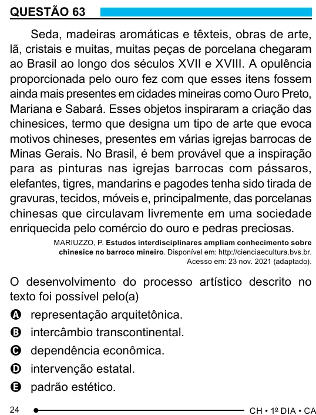

Texto extraído (pode conter ruído)

QUESTÃO 63  
Seda, madeiras aromáticas e têxteis, obras de arte,  
lã, cristais e muitas, muitas peças de porcelana chegaram  
ao Brasil ao longo dos séculos XVII e XVIII. A opulência  
proporcionada pelo ouro fez com que esses itens fossem  
ainda mais presentes em cidades mineiras como Ouro Preto,  
Mariana e Sabará. Esses objetos inspiraram a criação das  
chinesices, termo que designa um tipo de arte que evoca  
motivos chineses, presentes em várias igrejas barrocas de  
Minas Gerais. No Brasil, é bem provável que a inspiração  
para as pinturas nas igrejas barrocas com pássaros,  
elefantes, tigres, mandarins e pagodes tenha sido tirada de  
gravuras, tecidos, móveis e, principalmente, das porcelanas  
chinesas que circulavam livremente em uma sociedade  
enriquecida pelo comércio do ouro e pedras preciosas.  
MARIUZZO, P. Estudos interdisciplinares ampliam conhecimento sobre  
chinesice no barroco mineiro. Disponível em: http://cienciaecultura.bvs.br.  
Acesso em: 23 nov. 2021 (adaptado).  
O desenvolvimento do processo artístico descrito no  
texto foi possível pelo(a)  
A representação arquitetônica.  
B intercâmbio transcontinental.  
C dependência econômica.  
D intervenção estatal.  
E padrão estético.  
24

