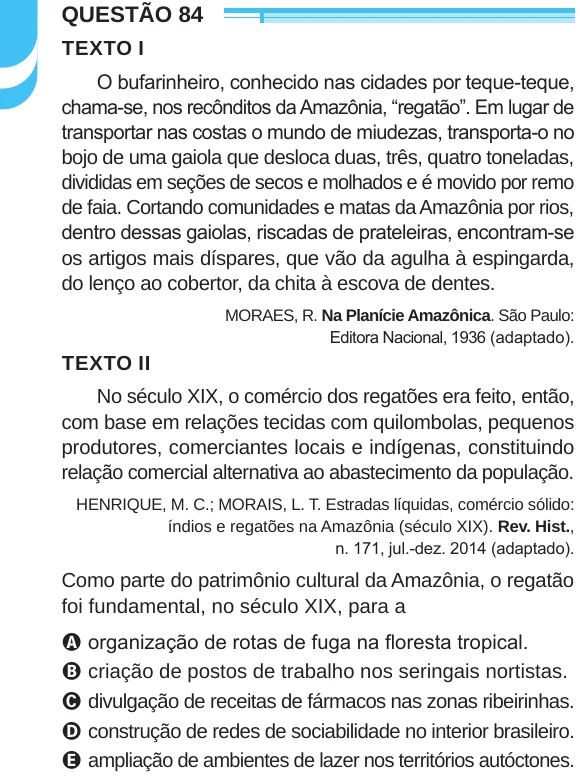

Texto extraído (pode conter ruído)

QUESTÃO 84  
TEXTO I  
O bufarinheiro, conhecido nas cidades por teque-teque,  
chama-se, nos recônditos da Amazônia, “regatão”. Em lugar de  
transportar nas costas o mundo de miudezas, transporta-o no  
bojo de uma gaiola que desloca duas, três, quatro toneladas,  
divididas em seções de secos e molhados e é movido por remo  
de faia. Cortando comunidades e matas da Amazônia por rios,  
dentro dessas gaiolas, riscadas de prateleiras, encontram-se  
os artigos mais díspares, que vão da agulha à espingarda,  
do lenço ao cobertor, da chita à escova de dentes.  
MORAES, R. Na Planície Amazônica. São Paulo:  
Editora Nacional, 1936 (adaptado).  
TEXTO II  
No século XIX, o comércio dos regatões era feito, então,  
com base em relações tecidas com quilombolas, pequenos  
produtores, comerciantes locais e indígenas, constituindo  
relação comercial alternativa ao abastecimento da população.  
HENRIQUE, M. C.; MORAIS, L. T. Estradas líquidas, comércio sólido:  
índios e regatões na Amazônia (século XIX). Rev. Hist.,  
n. 171, jul.-dez. 2014 (adaptado).  
Como parte do patrimônio cultural da Amazônia, o regatão  
foi fundamental, no século XIX, para a  
A organização de rotas de fuga na floresta tropical.  
B criação de postos de trabalho nos seringais nortistas.  
C divulgação de receitas de fármacos nas zonas ribeirinhas.  
D construção de redes de sociabilidade no interior brasileiro.  
E ampliação de ambientes de lazer nos territórios autóctones.

