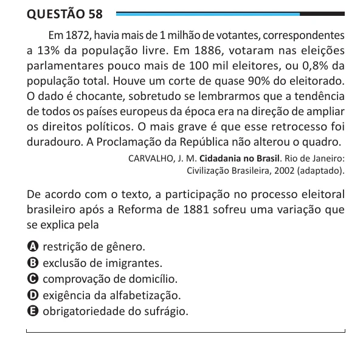

Texto extraído (pode conter ruído)

Questão 58  
Em 1872, havia mais de 1 milhão de votantes, correspondentes  
a 13% da população livre. Em 1886, votaram nas eleições  
parlamentares pouco mais de 100 mil eleitores, ou 0,8% da  
população total. Houve um corte de quase 90% do eleitorado.  
O dado é chocante, sobretudo se lembrarmos que a tendência  
de todos os países europeus da época era na direção de ampliar  
os direitos políticos. O mais grave é que esse retrocesso foi  
duradouro. A Proclamação da República não alterou o quadro.  
CARVALHO, J. M. Cidadania no Brasil. Rio de Janeiro:  
Civilização Brasileira, 2002 (adaptado).  
De acordo com o texto, a participação no processo eleitoral  
brasileiro após a Reforma de 1881 sofreu uma variação que  
se explica pela  
A restrição de gênero.  
B exclusão de imigrantes.  
C comprovação de domicílio.  
D exigência da alfabetização.  
E obrigatoriedade do sufrágio.

