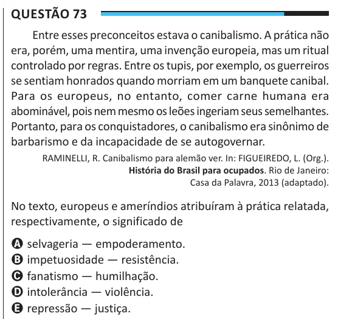

Texto extraído (pode conter ruído)

Questão 73  
Entre esses preconceitos estava o canibalismo. A prática não  
era, porém, uma mentira, uma invenção europeia, mas um ritual  
controlado por regras. Entre os tupis, por exemplo, os guerreiros  
se sentiam honrados quando morriam em um banquete canibal.  
Para os europeus, no entanto, comer carne humana era  
abominável, pois nem mesmo os leões ingeriam seus semelhantes.  
Portanto, para os conquistadores, o canibalismo era sinônimo de  
barbarismo e da incapacidade de se autogovernar.  
RAMINELLI, R. Canibalismo para alemão ver. In: FIGUEIREDO, L. (Org.).  
História do Brasil para ocupados. Rio de Janeiro:  
Casa da Palavra, 2013 (adaptado).  
No texto, europeus e ameríndios atribuíram à prática relatada,  
respectivamente, o significado de  
A selvageria — empoderamento.  
B impetuosidade — resistência.  
C fanatismo — humilhação.  
D intolerância — violência.  
E repressão — justiça.

