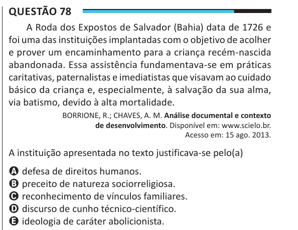

Texto extraído (pode conter ruído)

Questão 78  
A Roda dos Expostos de Salvador (Bahia) data de 1726 e  
foi uma das instituições implantadas com o objetivo de acolher  
e prover um encaminhamento para a criança recém-nascida  
abandonada. Essa assistência fundamentava-se em práticas  
caritativas, paternalistas e imediatistas que visavam ao cuidado  
básico da criança e, especialmente, à salvação da sua alma,  
via batismo, devido à alta mortalidade.  
BORRIONE, R.; CHAVES, A. M. Análise documental e contexto  
de desenvolvimento. Disponível em: www.scielo.br.  
Acesso em: 15 ago. 2013.  
A instituição apresentada no texto justificava-se pelo(a)  
A defesa de direitos humanos.  
B preceito de natureza sociorreligiosa.  
C reconhecimento de vínculos familiares.  
D discurso de cunho técnico-científico.  
E ideologia de caráter abolicionista.

