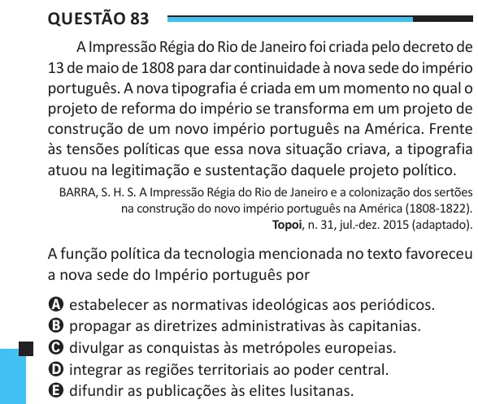

Texto extraído (pode conter ruído)

Questão 83  
A Impressão Régia do Rio de Janeiro foi criada pelo decreto de  
13 de maio de 1808 para dar continuidade à nova sede do império  
português. A nova tipografia é criada em um momento no qual o  
projeto de reforma do império se transforma em um projeto de  
construção de um novo império português na América. Frente  
às tensões políticas que essa nova situação criava, a tipografia  
atuou na legitimação e sustentação daquele projeto político.  
BARRA, S. H. S. A Impressão Régia do Rio de Janeiro e a colonização dos sertões  
na construção do novo império português na América (1808-1822).  
Topoi, n. 31, jul.-dez. 2015 (adaptado).  
A função política da tecnologia mencionada no texto favoreceu  
a nova sede do Império português por  
A estabelecer as normativas ideológicas aos periódicos.  
B propagar as diretrizes administrativas às capitanias.  
C divulgar as conquistas às metrópoles europeias.  
D integrar as regiões territoriais ao poder central.  
E difundir as publicações às elites lusitanas.

