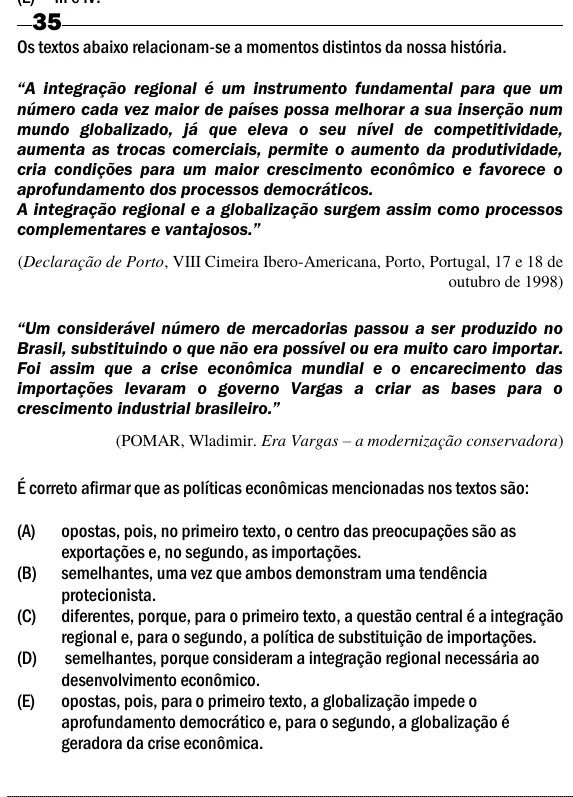

Texto extraído (pode conter ruído)

35  
Os textos abaixo relacionam-se a momentos distintos da nossa história.  
―A integração regional é um instrumento fundamental para que um  
número cada vez maior de países possa melhorar a sua inserção num  
mundo globalizado, já que eleva o seu nível de competitividade,  
aumenta as trocas comerciais, permite o aumento da produtividade,  
cria condições para um maior crescimento econômico e favorece o  
aprofundamento dos processos democráticos.  
A integração regional e a globalização surgem assim como processos  
complementares e vantajosos.‖  
(Declaração de Porto, VIII Cimeira Ibero-Americana, Porto, Portugal, 17 e 18 de  
outubro de 1998)  
―Um considerável número de mercadorias passou a ser produzido no  
Brasil, substituindo o que não era possível ou era muito caro importar.  
Foi assim que a crise econômica mundial e o encarecimento das  
importações levaram o governo Vargas a criar as bases para o  
crescimento industrial brasileiro.‖  
(POMAR, Wladimir. Era Vargas – a modernização conservadora)  
É correto afirmar que as políticas econômicas mencionadas nos textos são:  
(A)  
opostas, pois, no primeiro texto, o centro das preocupações são as  
exportações e, no segundo, as importações.  
(B)  
semelhantes, uma vez que ambos demonstram uma tendência  
protecionista.  
(C)  
diferentes, porque, para o primeiro texto, a questão central é a integração  
regional e, para o segundo, a política de substituição de importações.  
(D)  
semelhantes, porque consideram a integração regional necessária ao  
desenvolvimento econômico.  
(E)  
opostas, pois, para o primeiro texto, a globalização impede o  
aprofundamento democrático e, para o segundo, a globalização é  
geradora da crise econômica.

