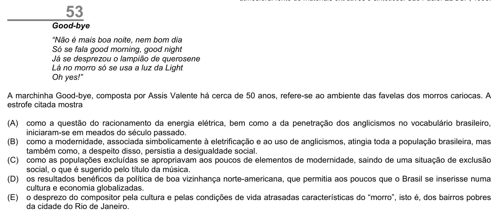

Texto extraído (pode conter ruído)

53  
Good-bye  
“Não é mais boa noite, nem bom dia  
Só se fala good morning, good night  
Já se desprezou o lampião de querosene  
Lá no morro só se usa a luz da Light  
Oh yes!”  
A marchinha Good-bye, composta por Assis Valente há cerca de 50 anos, refere-se ao ambiente das favelas dos morros cariocas. A  
estrofe citada mostra  
(A)  
como a questão do racionamento da energia elétrica, bem como a da penetração dos anglicismos no vocabulário brasileiro,  
iniciaram-se em meados do século passado.  
(B) como a modernidade, associada simbolicamente à eletrificação e ao uso de anglicismos, atingia toda a população brasileira, mas  
também como, a despeito disso, persistia a desigualdade social.  
(C) como as populações excluídas se apropriavam aos poucos de elementos de modernidade, saindo de uma situação de exclusão  
social, o que é sugerido pelo título da música.  
(D) os resultados benéficos da política de boa vizinhança norte-americana, que permitia aos poucos que o Brasil se inserisse numa  
cultura e economia globalizadas.  
(E) o desprezo do compositor pela cultura e pelas condições de vida atrasadas características do “morro”, isto é, dos bairros pobres  
da cidade do Rio de Janeiro.

