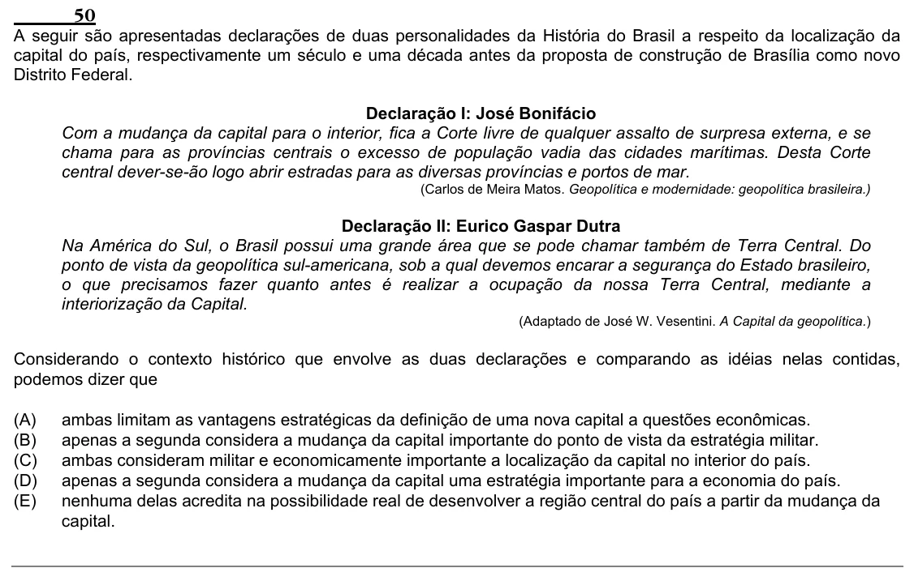

Texto extraído (pode conter ruído)

50  
A seguir são apresentadas declarações de duas personalidades da História do Brasil a respeito da localização da  
capital do país, respectivamente um século e uma década antes da proposta de construção de Brasília como novo  
Distrito Federal.  
Declaração I: José Bonifácio  
Com a mudança da capital para o interior, fica a Corte livre de qualquer assalto de surpresa externa, e se  
chama para as províncias centrais o excesso de população vadia das cidades marítimas. Desta Corte  
central dever-se-ão logo abrir estradas para as diversas províncias e portos de mar.  
(Carlos de Meira Matos. Geopolítica e modernidade: geopolítica brasileira.)  
Declaração II: Eurico Gaspar Dutra  
Na América do Sul, o Brasil possui uma grande área que se pode chamar também de Terra Central. Do  
ponto de vista da geopolítica sul-americana, sob a qual devemos encarar a segurança do Estado brasileiro,  
o que precisamos fazer quanto antes é realizar a ocupação da nossa Terra Central, mediante a  
interiorização da Capital.  
(Adaptado de José W. Vesentini. A Capital da geopolítica.)  
Considerando o contexto histórico que envolve as duas declarações e comparando as idéias nelas contidas,  
podemos dizer que  
(A)  
ambas limitam as vantagens estratégicas da definição de uma nova capital a questões econômicas.  
(B)  
apenas a segunda considera a mudança da capital importante do ponto de vista da estratégia militar.  
(C)  
ambas consideram militar e economicamente importante a localização da capital no interior do país.  
(D)  
apenas a segunda considera a mudança da capital uma estratégia importante para a economia do país.  
(E)  
nenhuma delas acredita na possibilidade real de desenvolver a região central do país a partir da mudança da  
capital.

