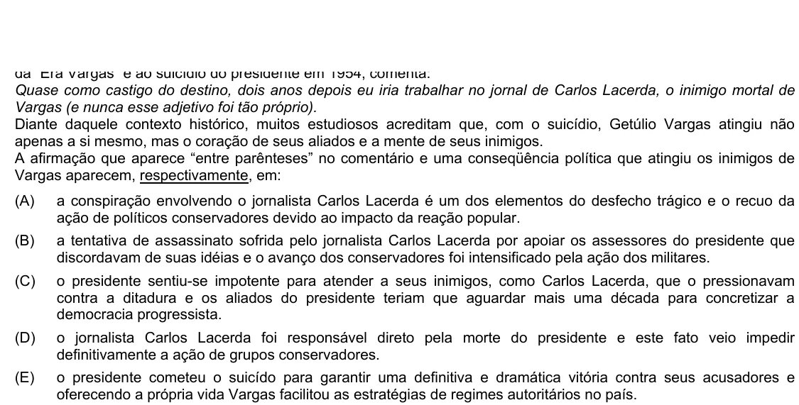

Texto extraído (pode conter ruído)

Quase como castigo do destino, dois anos depois eu iria trabalhar no jornal de Carlos Lacerda, o inimigo mortal de  
Vargas (e nunca esse adjetivo foi tão próprio).  
Diante daquele contexto histórico, muitos estudiosos acreditam que, com o suicídio, Getúlio Vargas atingiu não  
apenas a si mesmo, mas o coração de seus aliados e a mente de seus inimigos.  
A afirmação que aparece “entre parênteses” no comentário e uma conseqüência política que atingiu os inimigos de  
Vargas aparecem, respectivamente, em:  
(A)  
a conspiração envolvendo o jornalista Carlos Lacerda é um dos elementos do desfecho trágico e o recuo da  
ação de políticos conservadores devido ao impacto da reação popular.  
(B)  
a tentativa de assassinato sofrida pelo jornalista Carlos Lacerda por apoiar os assessores do presidente que  
discordavam de suas idéias e o avanço dos conservadores foi intensificado pela ação dos militares.  
(C)  
o presidente sentiu-se impotente para atender a seus inimigos, como Carlos Lacerda, que o pressionavam  
contra a ditadura e os aliados do presidente teriam que aguardar mais uma década para concretizar a  
democracia progressista.  
(D)  
o jornalista Carlos Lacerda foi responsável direto pela morte do presidente e este fato veio impedir  
definitivamente a ação de grupos conservadores.  
(E)  
o presidente cometeu o suicído para garantir uma definitiva e dramática vitória contra seus acusadores e  
oferecendo a própria vida Vargas facilitou as estratégias de regimes autoritários no país.

