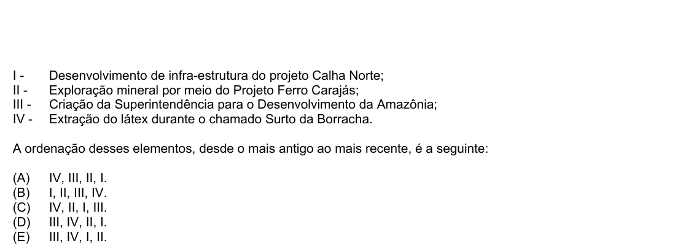

Texto extraído (pode conter ruído)

I -  
Desenvolvimento de infra-estrutura do projeto Calha Norte;  
II -  
Exploração mineral por meio do Projeto Ferro Carajás;  
III -  
Criação da Superintendência para o Desenvolvimento da Amazônia;  
IV -  
Extração do látex durante o chamado Surto da Borracha.  
A ordenação desses elementos, desde o mais antigo ao mais recente, é a seguinte:  
(A)  
IV, III, II, I.  
(B)  
I, II, III, IV.  
(C)  
IV, II, I, III.  
(D)  
III, IV, II, I.  
(E)  
III, IV, I, II.

