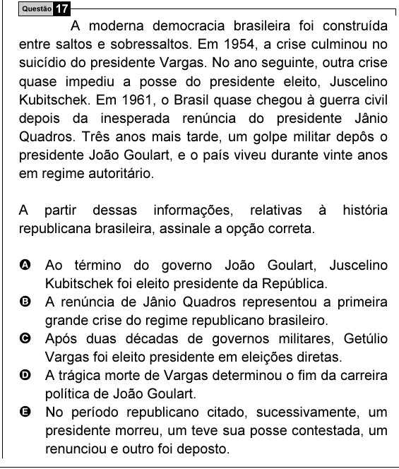

Texto extraído (pode conter ruído)

Questão 17  
A moderna democracia brasileira foi construída  
entre saltos e sobressaltos. Em 1954, a crise culminou no  
suicídio do presidente Vargas. No ano seguinte, outra crise  
quase impediu a posse do presidente eleito, Juscelino  
Kubitschek. Em 1961, o Brasil quase chegou à guerra civil  
depois da inesperada renúncia do presidente Jânio  
Quadros. Três anos mais tarde, um golpe militar depôs o  
presidente João Goulart, e o país viveu durante vinte anos  
em regime autoritário.  
A partir dessas informações, relativas à  
história  
republicana brasileira, assinale a opção correta.  
A Ao término do governo João Goulart, Juscelino  
Kubitschek foi eleito presidente da República.  
B A renúncia de Jânio Quadros representou a primeira  
grande crise do regime republicano brasileiro.  
C Após duas décadas de governos militares, Getúlio  
Vargas foi eleito presidente em eleições diretas.  
D A trágica morte de Vargas determinou o fim da carreira  
política de João Goulart.  
E No período republicano citado, sucessivamente, um  
presidente morreu, um teve sua posse contestada, um  
renunciou e outro foi deposto.

