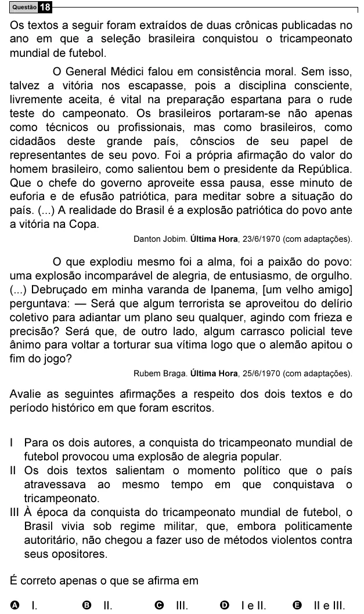

Texto extraído (pode conter ruído)

Questão 18  
Os textos a seguir foram extraídos de duas crônicas publicadas no  
ano em que a seleção brasileira conquistou o tricampeonato  
mundial de futebol.  
O General Médici falou em consistência moral. Sem isso,  
talvez a vitória nos escapasse, pois a disciplina consciente,  
livremente aceita, é vital na preparação espartana para o rude  
teste do campeonato. Os brasileiros portaram-se não apenas  
como técnicos ou profissionais, mas como brasileiros, como  
cidadãos deste grande país, cônscios de seu papel de  
representantes de seu povo. Foi a própria afirmação do valor do  
homem brasileiro, como salientou bem o presidente da República.  
Que o chefe do governo aproveite essa pausa, esse minuto de  
euforia e de efusão patriótica, para meditar sobre a situação do  
país. (...) A realidade do Brasil é a explosão patriótica do povo ante  
a vitória na Copa.  
Danton Jobim. Última Hora, 23/6/1970 (com adaptações).  
O que explodiu mesmo foi a alma, foi a paixão do povo:  
uma explosão incomparável de alegria, de entusiasmo, de orgulho.  
(...) Debruçado em minha varanda de Ipanema, [um velho amigo]  
perguntava: — Será que algum terrorista se aproveitou do delírio  
coletivo para adiantar um plano seu qualquer, agindo com frieza e  
precisão? Será que, de outro lado, algum carrasco policial teve  
ânimo para voltar a torturar sua vítima logo que o alemão apitou o  
fim do jogo?  
Rubem Braga. Última Hora, 25/6/1970 (com adaptações).  
Avalie as seguintes afirmações a respeito dos dois textos e do  
período histórico em que foram escritos.  
I Para os dois autores, a conquista do tricampeonato mundial de  
futebol provocou uma explosão de alegria popular.  
II Os dois textos salientam o momento político que o país  
atravessava ao mesmo tempo em que conquistava o  
tricampeonato.  
III À época da conquista do tricampeonato mundial de futebol, o  
Brasil vivia sob regime militar, que, embora politicamente  
autoritário, não chegou a fazer uso de métodos violentos contra  
seus opositores.  
É correto apenas o que se afirma em  
A I.  
B II.  
C III.  
D I e II.  
E II e III.

