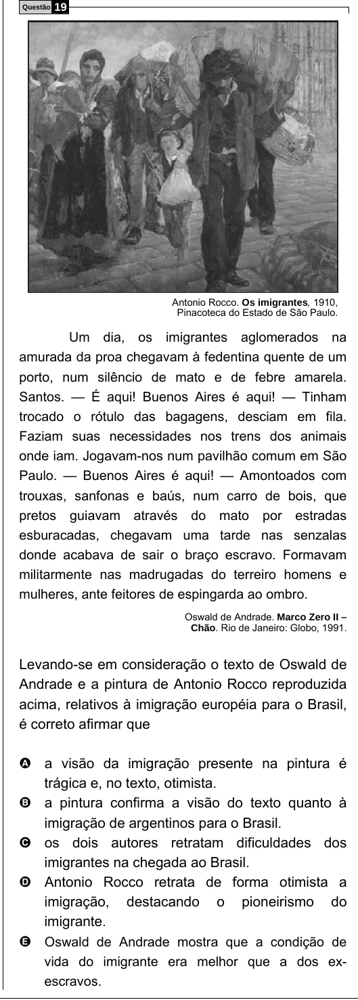

Texto extraído (pode conter ruído)

Questão  
19  
Antonio Rocco. Os imigrantes, 1910,  
Pinacoteca do Estado de São Paulo.  
Um dia, os imigrantes aglomerados na  
amurada da proa chegavam à fedentina quente de um  
porto, num silêncio de mato e de febre amarela.  
Santos. — É aqui! Buenos Aires é aqui! — Tinham  
trocado o rótulo das bagagens, desciam em fila.  
Faziam suas necessidades nos trens dos animais  
onde iam. Jogavam-nos num pavilhão comum em São  
Paulo. — Buenos Aires é aqui! — Amontoados com  
trouxas, sanfonas e baús, num carro de bois, que  
pretos guiavam através do mato por estradas  
esburacadas, chegavam uma tarde nas senzalas  
donde acabava de sair o braço escravo. Formavam  
militarmente nas madrugadas do terreiro homens e  
mulheres, ante feitores de espingarda ao ombro.  
Oswald de Andrade. Marco Zero II –  
Chão. Rio de Janeiro: Globo, 1991.  
Levando-se em consideração o texto de Oswald de  
Andrade e a pintura de Antonio Rocco reproduzida  
acima, relativos à imigração européia para o Brasil,  
é correto afirmar que  
A a visão da imigração presente na pintura é  
trágica e, no texto, otimista .  
B a pintura confirma a visão do texto quanto à  
imigração de argentinos para o Brasil .  
C os dois autores retratam dificuldades dos  
imigrantes na chegada ao Brasil .  
D Antonio Rocco retrata de forma otimista a  
imigração, destacando o pioneirismo do  
imigrante .  
E Oswald de Andrade mostra que a condição de  
vida do imigrante era melhor que a dos ex-  
escravos.

