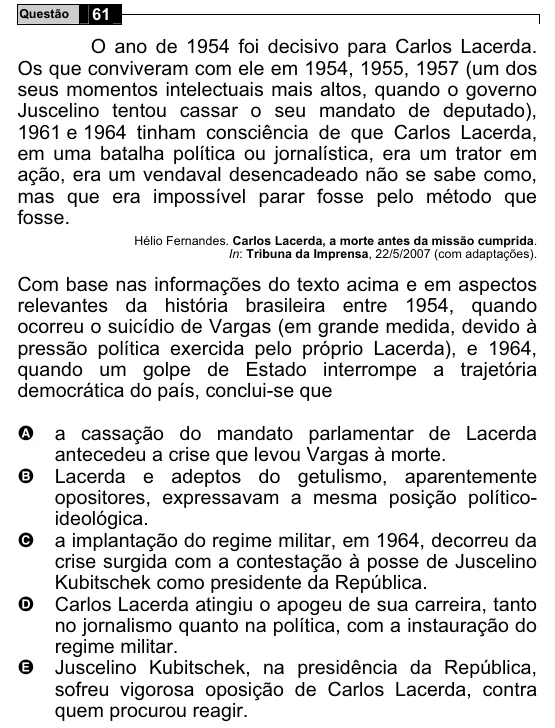

Texto extraído (pode conter ruído)

Questão  
61  
O ano de 1954 foi decisivo para Carlos Lacerda.  
Os que conviveram com ele em 1954, 1955, 1957 (um dos  
seus momentos intelectuais mais altos, quando o governo  
Juscelino tentou cassar o seu mandato de deputado),  
1961 e 1964 tinham consciência de que Carlos Lacerda,  
em uma batalha política ou jornalística, era um trator em  
ação, era um vendaval desencadeado não se sabe como,  
mas que era impossível parar fosse pelo método que  
fosse.  
Hélio Fernandes. Carlos Lacerda, a morte antes da missão cumprida.  
In: Tribuna da Imprensa, 22/5/2007 (com adaptações).  
Com base nas informações do texto acima e em aspectos  
relevantes da história brasileira entre 1954, quando  
ocorreu o suicídio de Vargas (em grande medida, devido à  
pressão política exercida pelo próprio Lacerda), e 1964,  
quando um golpe de Estado interrompe a trajetória  
democrática do país, conclui-se que  
a cassação do mandato parlamentar de Lacerda  
A  
antecedeu a crise que levou Vargas à morte.  
B  
Lacerda e adeptos do getulismo, aparentemente  
opositores, expressavam a mesma posição político-  
ideológica.  
a implantação do regime militar, em 1964, decorreu da  
C  
crise surgida com a contestação à posse de Juscelino  
Kubitschek como presidente da República.  
Carlos Lacerda atingiu o apogeu de sua carreira, tanto  
D  
no jornalismo quanto na política, com a instauração do  
regime militar.  
E  
Juscelino Kubitschek, na presidência da República,  
sofreu vigorosa oposição de Carlos Lacerda, contra  
quem procurou reagir.

